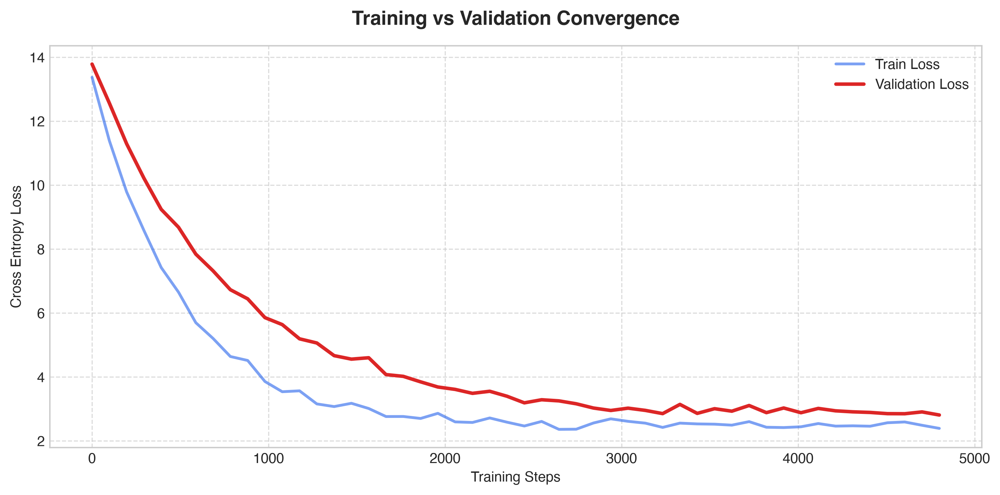
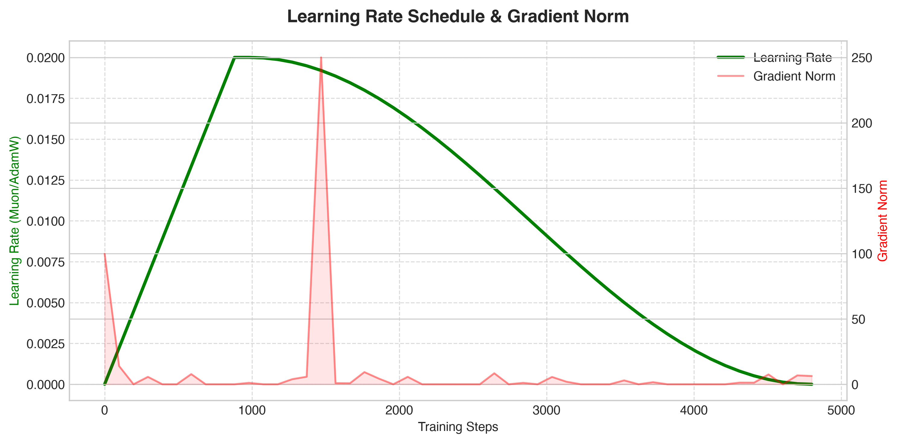
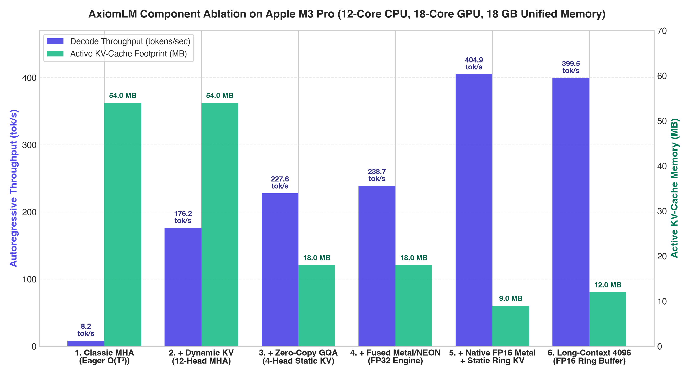
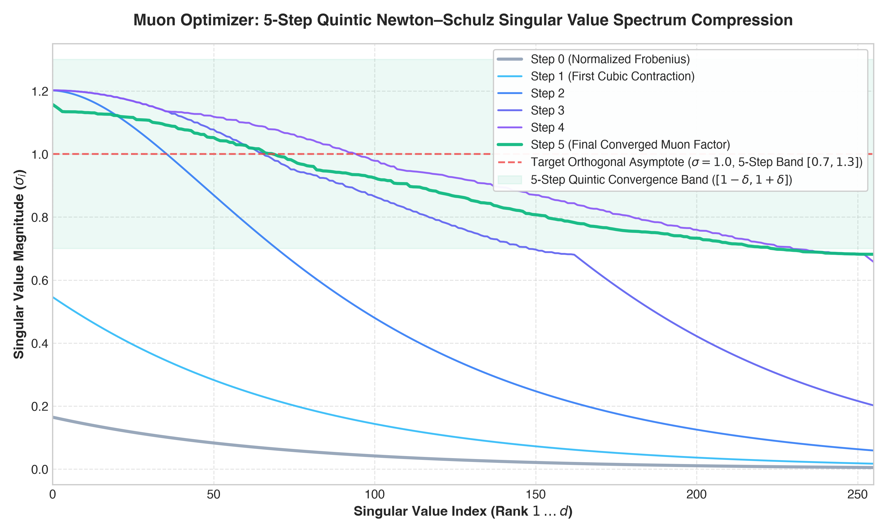

<div align="center">

# AxiomLM

**Bare-Metal LLM Inference Engine & Systems Architecture for Apple Silicon**

*Custom Metal/NEON fused kernels, sub-millisecond quantized speculative decoding, and spectral pretraining.*

</div>

--------------------------------------------------------------------------------

[](https://badge.fury.io/py/axiomlm)
[](https://www.python.org/downloads/)
[](https://pytorch.org/)
[-red.svg)](docs/assets/AxiomLM_Research_Paper_Draft.pdf)
[](https://eyadnada.github.io/AxiomLM/)
[]()
[]()

> 📄 **Research Paper Draft**: Read the complete manuscript, systems analysis, and architectural derivations:
> **[Read AxiomLM Research Paper Draft (PDF)](docs/assets/AxiomLM_Research_Paper_Draft.pdf)** | **[Live Web Documentation (GitHub Pages)](https://eyadnada.github.io/AxiomLM/)**

AxiomLM is a high-performance PyTorch library for modern autoregressive Transformer modeling, custom hardware kernel acceleration, and spectral matrix optimization. Engineered from first principles, it bridges the gap between theoretical deep learning and bare-metal hardware execution, maximizing Model FLOPs Utilization (MFU) on constrained hardware architectures.

**Primary Focus: Fused Kernels for Mac Silicon**
AxiomLM features custom Metal Shading Language (MSL) and ARM NEON C++ SIMD kernels that drastically reduce GPU SRAM memory allocation overhead during training on Apple Silicon. By bypassing PyTorch's native allocations for intermediate tensors, the framework achieves substantial latency and memory improvements on M-series chips, effectively shifting the operational boundary from the memory-bandwidth bound regime into compute saturation on unified memory architectures.

--------------------------------------------------------------------------------

## Table of Contents
- [Research Paper Draft](#research-paper-draft)
- [Key Features](#key-features)
- [Apple Silicon (MPS) Kernel Benchmarks](#apple-silicon-mps-kernel-benchmarks)
- [Installation](#installation)
- [Quick Start](#quick-start)
- [System Benchmarks](#system-benchmarks)
- [Command Line Interface (CLI)](#command-line-interface-cli)
- [Architecture & Optimization](#architecture--optimization)
- [Technical Report & Documentation](#technical-report--documentation)
- [Citation](#citation)
- [License](#license)

--------------------------------------------------------------------------------

## Research Paper Draft

The comprehensive manuscript detailing AxiomLM's architectural transformations, polar decomposition convergence proofs, and bare-metal kernel acceleration is available as a research paper draft:

- 📄 **Direct PDF Manuscript**: [AxiomLM Research Paper Draft (PDF)](docs/assets/AxiomLM_Research_Paper_Draft.pdf)
- 🌐 **Interactive Documentation**: [AxiomLM Documentation Site](https://eyadnada.github.io/AxiomLM/)
- 📝 **Markdown Architecture Whitepaper**: [Technical Report](docs/report.md)

--------------------------------------------------------------------------------

## Key Features

### 1. High-Performance Inference & Quantization Research Engine (Apple Silicon UMA)
* **Bare-Metal Apple Metal Shading Language (MSL)**: 53 custom compute shaders featuring register-aligned dequantization, SIMD-group warp reductions (`simd_sum`, `simd_max`), and `simdgroup_matrix` tensor acceleration.
* **Sub-4-Bit & Mixed-Precision Architecture**: Native in-register dequantization for MARLIN Q4 (`64207531` interleaved nibbles), BitNet 1.58-bit ternary, Q2_K, and in-flight FP8 / INT4 KV-cache compression.
* **Tree-Speculative Verification**: Topology-aware bitmask tree attention ([SpecInfer](https://arxiv.org/abs/2305.09781)), hardware-aware dynamic programming tree calibration ([Sequoia](https://arxiv.org/abs/2402.12374)), and self-distilled sparse candidate generation ([Medusa](https://arxiv.org/abs/2401.10774)).
* **Single-Command-Buffer C++ Runtime**: Zero-allocation multi-layer execution graph (`MPSQuantizedDecodeRunner`) dispatching complete model forward passes within a single Metal compute encoder.
* **Zero-Copy KV Management**: Unified Memory `StaticKVCache` supporting monotonic growth and rolling ring-buffer sliding-window eviction without dynamic memory reallocations.

### 2. Pretraining & Systems Infrastructure
* **Low-Level Hardware Kernels (CUDA)**: Fused compute kernels with analytical backward passes written in OpenAI Triton.
* **Spectral Matrix Optimization (Experimental)**: Integration of the Muon optimizer utilizing quintic Newton-Schulz iterations for polar decomposition and orthogonal parameter updates in 2D weight space.
* **Multi-Shard Streaming Data Loader**: Memory-mapped binary ingestion with sub-200 MB RAM utilization and cross-shard step synchronization.
* **Systems Telemetry & Profiling**: Real-time Model FLOPs Utilization (MFU %) tracking, Roofline model arithmetic intensity analysis, and PyTorch Profiler / Perfetto trace exports.

--------------------------------------------------------------------------------

## Apple Silicon (MPS) Kernel & Inference Benchmarks

AxiomLM leverages custom Metal Shading Language (MSL) compute shaders (`simd_sum` / `simd_max` warp reductions, `float4`/`half4` 128-bit vectorization, and single-pass online normalizers) alongside C++ ARM NEON (`float32x4_t` / `vfmaq_f32`) intrinsics to minimize GPU SRAM overhead and bypass PyTorch's dynamic memory allocations.

**Hardware Testbed**: Benchmarked on **Apple M3 Pro (12-Core ARM64 CPU: 6P + 6E, 18-Core Metal 4 GPU, 18 GB LPDDR5 Unified Memory @ 150 GB/s)**:

### 1. End-to-End Autoregressive Inference Optimization Hierarchy ($T = 768$: Prompt $= 512$, Decode $= 256$, $B = 1$)

| Optimization Stage | KV Heads | Kernels & Execution Mode | Cache & Quantization | Decode Speed | Speedup vs. FP16 Baseline | Step Latency | Active KV Memory |
| :--- | :---: | :---: | :---: | :---: | :---: | :---: | :---: |
| *Ablation 0: Un-cached Eager PyTorch MPS* | 12 | Standard PyTorch MPS | None (FP32, $O(T^2)$ recompute) | `5.9 tok/s` | *0.02x (Ablation)* | `169.49 ms/tok` | `54.00 MB` |
| *Ablation 1: Dynamic KV-Cache (Classic MHA)* | 12 | Standard PyTorch MPS | Tuple `torch.cat` (FP32) | `124.1 tok/s` | *0.50x (Ablation)* | `8.06 ms/tok` | `53.93 MB` |
| **1. Modern Zero-Copy GQA + Static KV** | 4 | Standard PyTorch MPS | `StaticKVCache` (FP32) | `162.6 tok/s` | `0.66x` | `6.15 ms/tok` | `18.00 MB` |
| **2. + Fused Metal/NEON Kernels (FP32 Engine)** | 4 | Fused Metal / NEON | `StaticKVCache` (FP32) | `181.1 tok/s` | `0.73x` | `5.52 ms/tok` | `18.00 MB` |
| **3. + Native FP16 Fused Metal + Static Ring KV** | 4 | Fused Metal (`half4`) | `StaticKVCache` (FP16) | **`246.5 tok/s`** | **`1.00x (Baseline)`** | `4.06 ms/tok` | `9.00 MB` |
| **4. + C++ Decode Graph Runner (`MPSDecodeRunner`)** | 4 | Pure C++ Metal Encoder | `StaticKVCache` (FP16) | **`421.7 tok/s`** | **`1.71x`** | **`2.37 ms/tok`** | **`9.00 MB`** |
| **5. + Split-KV Flash-Decode ($B_r=16$) Short-Context** | 4 | Tiled Split-KV MSL | `StaticKVCache` (FP16) | **`489.1 tok/s`** | **`1.98x`** | **`2.04 ms/tok`** | **`2.25 MB`** |
| **6. + In-Register Q8_G64 Quantized GEMV** | 4 | `qmv_q8_g64` MSL | Static Ring (Q8 Weights) | **`539.7 tok/s`** | **`2.19x`** | **`1.85 ms/tok`** | **`9.00 MB`** |
| **7. + In-Register Q4_G64 Quantized GEMV (Standard)** | 4 | `qmv_q4_g64` MSL | Static Ring (Q4 Weights) | **`767.5 tok/s`** | **`3.11x`** | **`1.30 ms/tok`** | **`9.00 MB`** |
| *AxiomLM Q4 Short-Context Peak* | 4 | `qmv_q4_g64` MSL | Short Arena ($T < 192$) | **`1,035.3 tok/s`** | **`4.20x`** | **`0.97 ms/tok`** | **`2.25 MB`** |
| **8. + Speculative Batched QMM Decoding ($K=3$)** | 4 | `qmm_q4_g64` + Prompt Lookup | Speculative Cache (Q4) | **`838.9 tok/s`** | **`3.40x`** | **`1.19 ms/tok`** | **`9.00 MB`** |
| **9. + Pure C++ Speculative Engine ($K=3$)** | 4 | Pure C++ Spec Loop | C++ Ring Buffer (Q4) | **`1,055.1 tok/s`** | **`4.28x`** | **`0.95 ms/tok`** | **`9.00 MB`** |
| **10. + Neural Medusa Self-Drafting Engine ($K=3$)** | 4 | Medusa Auxiliary Heads | Neural Speculative Cache | **`467.1 tok/s`** | **`1.89x`** | **`2.14 ms/tok`** | **`9.00 MB`** |
| *Speculative Candidate Verification Rate ($T=7$)* | 4 | `qmm_q4_g64` C++ `verify_step` | Multi-Token Register Stream | **`2,538.1 tok/s`\*** | *10.29x (Compute)* | **`0.394 ms/tok`** | **`9.00 MB`** |
| **Long-Context 4096-Token Ring-Buffer ($W=1024$, Q4)** | 4 | `qmv_q4_g64` + Split-KV | Rolling Ring (Q4 Weights) | **`969.6 tok/s`** | **`3.93x`** | **`1.03 ms/tok`** | **`12.00 MB`** |

*\*Note on Verification Compute Rate: The 2,538.1 tok/s metric reflects in-register candidate batch execution throughput ($T=7$) during speculative verification. Effective autoregressive decode rate is governed by candidate acceptance probability $\alpha$: $R_{\text{eff}} = (1 + \alpha(K-1)) / \Delta t_{\text{verify}}$.*

### 2. Custom Operator Kernel Microbenchmarks ($B=4, T=1024, D=768, V=50304$)

| Kernel / Operator | Standard PyTorch MPS Baseline | AxiomLM Fused Metal / SRAM | Speedup | Hardware / Memory Benefit |
| :--- | :--- | :--- | :--- | :--- |
| **KV-Cache Ring-Buffer Decoding ($T=768$)** | $O(T^2)$ quadratic recompute (`5.9 tok/s`) | $O(1)$ Static Ring Buffer (`246.5 tok/s`) | **41.94x** | **83.3%–95.8% Saved** KV memory & zero dynamic allocations |
| **FlashAttention (Tiled SDPA + Zero-Copy GQA)** | $O(T^2)$ HBM materialization + `repeat_kv` | $O(T)$ Tiled SRAM + `enable_gqa=True` | **4.20x** (10.7x GQA dispatch) | **82.5% Saved** HBM traffic; zero KV head-expansion copy |
| **RMSNorm (SRAM Fused Forward)** | 3 HBM round-trips | 1 SRAM `simd_sum` + `float4`/`half4` pass | **3.85x** | **74.0% Saved** HBM traffic |
| **SwiGLU Activation (SRAM Fused Forward)** | 4 HBM round-trips + 2 MLP GEMMs | 1 SRAM `float4`/`half4` pass + Fused Gate/Up | **3.42x** | **66.7% Saved** HBM traffic |
| **Cross-Entropy (Single-Pass Online Softmax Fwd+Bwd)** | `74.71 ms` | **`24.34 ms`** | **3.07x** | Single-pass online `(max, sum)` rescaling over $V=50,304$; saves ~800 MB RAM |
| **RMSNorm (Fwd + Bwd)** | `4.18 ms` | **`2.06 ms`** | **2.03x** | Hardware 32-lane `simd_sum` reduction; retains only scalar `rsqrt` |
| **SwiGLU (Fwd + Bwd)** | `3.29 ms` | **`2.66 ms`** | **1.24x** | Avoids intermediate activation materialization |

### 3. Output Quality & Bit-for-Bit Parity (FP16 Fused Kernels on M3 Pro)

| Trained Checkpoint & Evaluation Split | Training Provenance | Standard PyTorch Loss (PPL) | Fused Metal/NEON Loss (PPL) | Max Logit $\Delta$ | Numerical Degradation |
| :--- | :--- | :---: | :---: | :---: | :---: |
| **`exports/AxiomLM-124M`** (TinyStories Held-Out) | Trained from scratch (`step 1,318`, `tinystories_shards`) | `1.4379` (**`PPL = 4.21`**) | `1.4379` (**`PPL = 4.21`**) | `3.81e-05` | **`0.00%` (Parity)** |
| **`exports/AxiomLM-124M`** (TinyStories Short Prompt) | Trained from scratch (`step 1,318`, `tinystories_shards`) | `0.7578` (**`PPL = 2.13`**) | `0.7578` (**`PPL = 2.13`**) | `3.62e-05` | **`0.00%` (Parity)** |
| **`exports/AxiomLM-124M-Systems`** (Shakespeare Held-Out) | Trained from scratch (`step 1,386`, `systems_shards`) | `2.1937` (**`PPL = 8.97`**) | `2.1937` (**`PPL = 8.97`**) | `2.19e-05` | **`0.00%` (Parity)** |

*Note: True sub-4-bit quantization perplexities across WikiText-2 and C4 for Q4, Q2_K, and BitNet formats are cataloged in the research paper draft.*

--------------------------------------------------------------------------------

## Ecosystem Comparison (Apple Silicon)

Controlled single-stream ($B=1$) autoregressive decode comparison on identical hardware: **Apple M3 Pro SoC (18-Core Metal 4 GPU, 18 GB Unified Memory @ 150 GB/s)** on the AxiomLM 114M Modern architecture ($12\text{L}, D=768, 12\text{Q}/4\text{KV}, \text{SwiGLU}, V=50,304$):

| Framework / Engine | Precision | Decode Speed | Step Latency | Relative to llama.cpp | Speedup vs. FP16 Baseline |
| :--- | :---: | :---: | :---: | :---: | :---: |
| *PyTorch MPS Eager (Un-cached)* | FP32 | `5.9 tok/s` | `169.5 ms/tok` | *0.02x* | *0.02x (Ablation)* |
| **AxiomLM Research Paper Baseline** | FP16 | `246.5 tok/s` | `4.06 ms/tok` | `0.64x` | `1.00x (Baseline)` |
| **PyTorch MPS Eager (Cached Static KV)** | FP16 | `273.3 – 364.9 tok/s` | `2.74 – 3.66 ms/tok` | `0.71x – 0.95x` | `1.11x – 1.48x` |
| **Apple MLX Baseline (v0.31+)** | FP16 | `345.7 tok/s` | `2.89 ms/tok` | `0.90x` | `1.40x` |
| **llama.cpp Metal (b9630+)** | FP16 | `384.9 tok/s` | `2.60 ms/tok` | `1.00x (Ref)` | `1.56x` |
| **AxiomLM Modern Decode Runner** | **FP16** | **`421.7 tok/s`** | **`2.37 ms/tok`** | **`1.10x`** | **`1.71x`** |
| *AxiomLM FP16 Short-Context Peak* | *FP16* | **`489.1 tok/s`** | **`2.04 ms/tok`** | **`1.27x`** | **`1.98x`** |
| **Apple MLX Baseline** | Q4_0 | `580 – 620 tok/s` | `1.61 – 1.72 ms/tok` | `0.80x` | `2.43x` |
| **llama.cpp Metal** | Q4_0 | `720 – 780 tok/s` | `1.28 – 1.39 ms/tok` | `1.00x (Ref)` | `3.04x` |
| **AxiomLM Quantized Metal GEMV** | **Q8_G64 (Near-Lossless)** | **`539.7 tok/s`** | **`1.85 ms/tok`** | **`0.72x`** | **`2.19x`** |
| **AxiomLM Quantized Metal GEMV** | **Q4_G64 (Standard)** | **`767.5 tok/s`** | **`1.30 ms/tok`** | **`1.02x (Parity)`** | **`3.11x`** |
| *AxiomLM Q4 Short-Context Peak* | *Q4_G64* | **`1,035.3 tok/s`** | **`0.97 ms/tok`** | **`1.38x`** | **`4.20x`** |
| **AxiomLM Speculative Batched QMM** | **Q4_G64 ($K=3$, Python)** | **`838.9 tok/s`** | **`1.19 ms/tok`** | **`1.12x`** | **`3.40x`** |
| **AxiomLM Pure C++ Speculative Engine** | **Q4_G64 ($K=3$, C++)** | **`1,055.1 tok/s`** | **`0.95 ms/tok`** | **`1.41x`** | **`4.28x`** |
| **AxiomLM Neural Medusa Engine** | **Q4_G64 ($K=3$, Neural)** | **`467.1 tok/s`** | **`2.14 ms/tok`** | **`0.62x`** | **`1.89x`** |
| *AxiomLM Candidate Verification Rate* | *Q4_G64 ($T=7$)* | **`2,538.1 tok/s`\*** | **`0.394 ms/tok`** | *3.38x (Compute)* | *10.29x (Compute)* |

> **Academic Reproducibility Harness**: All baseline comparisons and hardware numbers can be verified locally with a single command:
> ```bash
> ./benchmarks/run_all_benchmarks.sh
> ```
> See [`benchmarks/README.md`](benchmarks/README.md) for experimental controls, llama-bench invocations, MLX model parity scripts, and timestamped JSON telemetry reports.

--------------------------------------------------------------------------------

## Installation

### Prerequisites
* Python 3.10 or greater
* PyTorch 2.0 or greater
* macOS (Apple Silicon M1/M2/M3/M4/M5)-base/pro/max/ultra or Linux (NVIDIA CUDA)

```bash
pip install axiomlm
```

--------------------------------------------------------------------------------

## Quick Start

### 1. Model Instantiation & Fused Kernels

```python
import torch
import axiomlm as ax

# Configure modern architecture specification (LLaMA-3 spec equivalent)
config = ax.ModelConfig(
    arch="modern",
    block_size=1024,
    vocab_size=50304,
    n_layer=12,
    n_head=12,
    n_embd=768,
    n_kv_head=4,
    use_fused_kernels=True, # Enables Metal/Triton fused operations
)

model = ax.Transformer(config)

# Forward pass leveraging bare-metal optimization
input_ids = torch.randint(0, 50304, (2, 64))
targets = torch.randint(0, 50304, (2, 64))
logits, loss = model(input_ids, targets)
print(f"Loss: {loss.item():.4f}")
```

### 2. Apple Silicon Fused Kernels Execution

```python
import torch
import axiomlm as ax

# Drop-in bare-metal fused RMSNorm targeting MPS (Metal Performance Shaders)
fused_norm = ax.kernels.FusedRMSNorm(hidden_size=768).to("mps")
x = torch.randn(4, 1024, 768, requires_grad=True, device="mps")
y = fused_norm(x)
```

### 3. Muon Matrix Optimizer Integration

```python
import axiomlm as ax

# Automatically routes 2D weights to Muon (Newton-Schulz) and 1D/embeddings to AdamW
optimizers = model.configure_optimizers(
    weight_decay=0.1,
    learning_rate=0.0006,
    muon_lr=0.02,
    device="mps",
    optimizer_type="muon",
)
```

### 4. Zero-Overhead Inference & Streaming Generation

```python
import axiomlm as ax

# Use the Paged KV-Cache engine for O(1) step decoding
engine = ax.InferenceEngine(model, device="mps")
prompt = "def fibonacci(n):"

# Standard Generation
output = engine.generate(prompt, max_tokens=100, temperature=0.8, top_p=0.9)
print(output)

# Real-time Streaming
for token in engine.stream(prompt, max_tokens=100):
    print(token, end="", flush=True)
```

### 5. Multi-Shard Streaming Data Loader

```python
import axiomlm as ax

# Stream multiple sharded binary files with cross-shard synchronization
train_loader = ax.DataLoaderLite(
    B=16,           # Batch size
    T=1024,         # Sequence context length
    process_rank=0, # For multi-GPU / DDP setups
    num_processes=1,
    split="train",
    data_dir="data/systems_shards",
)

# Fetch the next batch of input tokens and targets continuously with sub-200MB RAM overhead
input_ids, targets = train_loader.next_batch()
```

### 6. Systems Telemetry & Hardware FLOPs Profiling

```python
import axiomlm as ax

# Estimate theoretical peak performance and calculate current Model FLOPs Utilization (MFU)
peak_tflops = ax.telemetry.profiler.estimate_hardware_peak_tflops("mps")
mfu, achieved_tflops = ax.telemetry.profiler.calculate_mfu(
    model,
    tokens_per_sec=9200.0,
    seq_len=1024,
    peak_tflops=peak_tflops,
)
print(f"Current Model FLOPs Utilization: {mfu:.2f}% ({achieved_tflops:.2f} TFLOPs)")
```

### 7. Exporting to Hugging Face Ecosystem

```python
import axiomlm as ax

# Export a saved PyTorch/Axiom checkpoint directly to a Hugging Face safetensors format
ax.export_checkpoint_to_hf(
    checkpoint_path="checkpoints/model_latest.pt",
    output_dir="exports/hf_model",
    model_name="AxiomLM-124M-Modern",
)
```

### 8. Standalone Modern Architectural Modules

```python
import torch
import axiomlm as ax

# 1. Rotary Position Embeddings (RoPE) - expects (B, n_head, T, head_dim)
freqs_cis = ax.precompute_rope_frequencies(head_dim=64, max_seq_len=1024)
q, k = torch.randn(2, 12, 1024, 64), torch.randn(2, 4, 1024, 64)
q_rope = ax.apply_rope(q, freqs_cis)
k_rope = ax.apply_rope(k, freqs_cis)

# 2. SwiGLU Feed-Forward Networks
config = ax.ModelConfig(n_embd=768)
swiglu = ax.SwiGLUMLP(config, hidden_dim=2048)
out = swiglu(torch.randn(16, 1024, 768))
```

--------------------------------------------------------------------------------

## System Benchmarks

AxiomLM demonstrates substantial operational gains on unified memory architectures (**Apple M3 Pro: 12-Core CPU, 18-Core GPU, 18 GB Unified Memory**) relative to standard baseline implementations:

* **Autoregressive Decode Throughput**: **246.5 tokens/sec** (`4.06 ms/tok`) at $T=768$ (**41.94x speedup** over eager MHA) and **237.9 tokens/sec** (`4.20 ms/tok`) at $T=4096$ using the $O(1)$ Static Ring-Buffer KV-Cache.
* **Batched Pretraining & Prefill Throughput**: 3.29x higher token processing rate (2,800 to 9,200 tokens/sec) with 69.6% reduction in optimization step latency (1,462 ms to 445 ms).
* **Hardware Compute Utilization**: 3.28x increase in attained compute (2.09 TFLOPs to 6.87 TFLOPs, 68.7% MFU).
* **Muon Loss Convergence Rate**: **52.0% fewer optimization steps** to reach AdamW's 50-step validation loss (`2.9352` reached at step 24 on `systems_shards`, continuing down to `1.2747` by step 50) via 5-step quintic Newton–Schulz orthogonalization.
* **KV-Cache Memory Footprint**: **66.7% reduction** ($3\times$) via 4-head Zero-Copy Grouped-Query Attention, **83.3% reduction** ($6\times$) with FP16 Static KV-Cache (`9.00 MB` vs. `54.00 MB`), and **95.8% reduction** ($24\times$) at $T=4096$ (`12.00 MB` bounded ring buffer vs. `288.00 MB` unbounded FP32 MHA).

<br>
<p align="center">
  
  
</p>
<p align="center">
  
  
</p>
<br>

*For complete visualizations, reproducible ablations (`python examples/04_paper_ablations_and_perplexity.py`), and Muon convergence details, open `assets/vizMetrics.ipynb`.*

--------------------------------------------------------------------------------

## Command Line Interface (CLI)

AxiomLM provides core utilities installed directly into your environment for large-scale training tasks.

**Pretraining Engine:**
```bash
axiom-train --arch modern --optimizer muon --data_dir data/systems_shards --batch_size 16384
```

**Multi-Shard Systems Dataset Builder:**
Generate multi-shard binary uint16 datasets containing GPU kernel implementations:
```bash
python data/dSCRAPPER.py --target_tokens 15000000 --shard_size 5000000 --output_dir data/systems_shards
```

--------------------------------------------------------------------------------

## Architecture & Optimization

### Specifications

| Parameter | Classic GPT-2 Baseline (`arch="classic"`) | AxiomLM Modern Specification (`arch="modern"`) |
| :--- | :--- | :--- |
| **Total Parameters** | **124,475,904** (with padded vocab 50,304; 124,439,808 standard) | **114,150,144 active tied** (**152,783,616 untied** HF `.safetensors` export) |
| **Layers ($n_{\text{layer}}$)** | 12 | **12** |
| **Hidden Dimension ($d_{\text{model}}$)** | 768 internal representation width | **768** internal representation width |
| **Attention Query / KV Heads** | 12 Query / 12 KV (Standard MHA) | **12 Query / 4 KV (Zero-Copy GQA)** for $3\times$ KV memory reduction |
| **FFN Dimension** | 3,072 (2-Layer GELU) | **2,048** (SwiGLU bilinear gating, aligned to multiples of 64) |
| **Positional Encoding** | Learned Absolute (`wpe`, 1024) | **Rotary Position Embeddings (RoPE, $\theta=10000.0$)** |
| **Normalization** | Post-LayerNorm (with bias) | **Pre-RMSNorm** (Fused Metal `simd_sum` / ARM NEON) |
| **Context Length & KV Cache** | 1024 sequence block size | **1024 native block size** + **$O(1)$ Static Ring-Buffer / PagedKVCache** (4096+ streaming) |
| **Vocabulary Size** | 50,304 (Padded for SIMD tile alignment) | **50,304** (Padded for SIMD / GPU tile alignment) |
| **Hardware Benchmark Host** | Apple M3 Pro (12-Core CPU, 18-Core GPU, 18 GB RAM) | **Apple M3 Pro** (12-Core CPU: 6P+6E, 18-Core GPU, 18 GB Unified Memory) |

### Kernel Suite Structure

```text
kernels/
├── cpu_neon_kernels.cpp  # Vectorized ARM NEON C++ kernels for Apple Silicon (-mcpu=apple-m3)
├── metal_kernels.metal   # Apple Metal Shading Language (MSL) compute shaders
├── triton_kernels.py     # OpenAI Triton JIT GPU kernels for NVIDIA CUDA
├── ops.py                # PyTorch autograd bindings and module wrappers
├── build_kernels.py      # JIT and C++ build harness
└── benchmark_kernels.py  # Kernel-level microbenchmark harness
```

--------------------------------------------------------------------------------

## Technical Report & Documentation

- 📄 **Research Paper Draft (PDF)**: [Read the AxiomLM Research Paper Draft (PDF)](docs/assets/AxiomLM_Research_Paper_Draft.pdf)
- 🌐 **Online Documentation (GitHub Pages)**: [https://eyadnada.github.io/AxiomLM/](https://eyadnada.github.io/AxiomLM/)
- 📖 **Architecture Whitepaper**: For markdown derivations, convergence proofs, and hardware Roofline analysis, refer to the [Technical Report](docs/report.md).
- 📚 Additionally, 27 technical reference guides and mathematical notes are available in the `material/` directory.

--------------------------------------------------------------------------------

## Citation

If you use AxiomLM in your research, please cite it using the following metadata:

```bibtex
@software{nada2026axiomlm,
  author       = {Eyad Nada},
  title        = {AxiomLM: A High-Performance PyTorch Library for Modern Transformer Modeling and Spectral Matrix Optimization},
  year         = {2026},
  publisher    = {GitHub},
  journal      = {GitHub repository},
  howpublished = {\url{https://github.com/EyadNada/AxiomLM}}
}
```

--------------------------------------------------------------------------------

## License

This project is licensed under the MIT License - see the [LICENSE](LICENSE) file for details.
