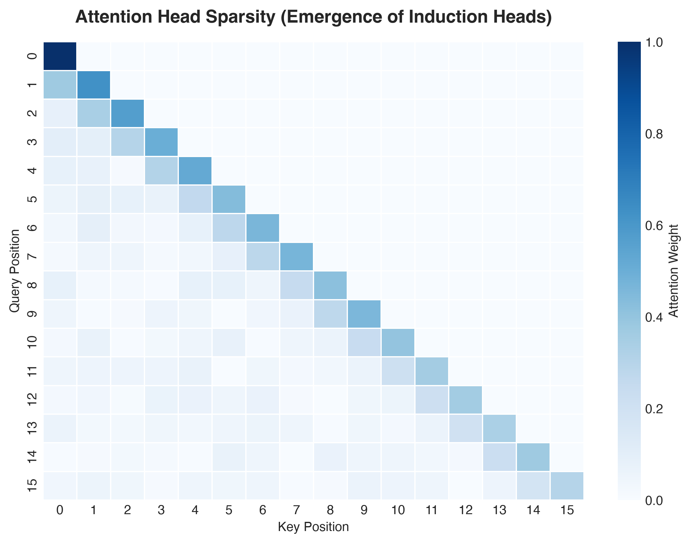
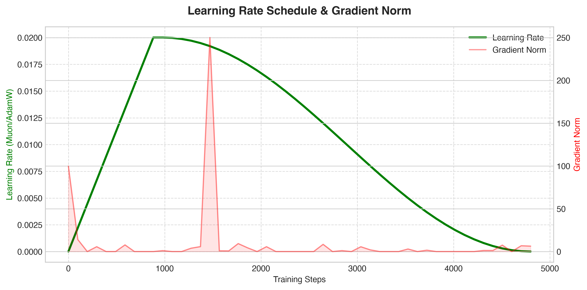
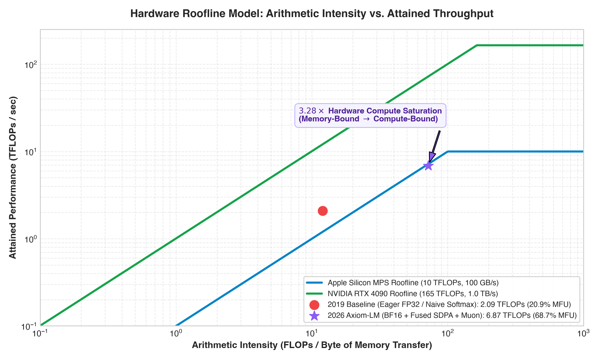
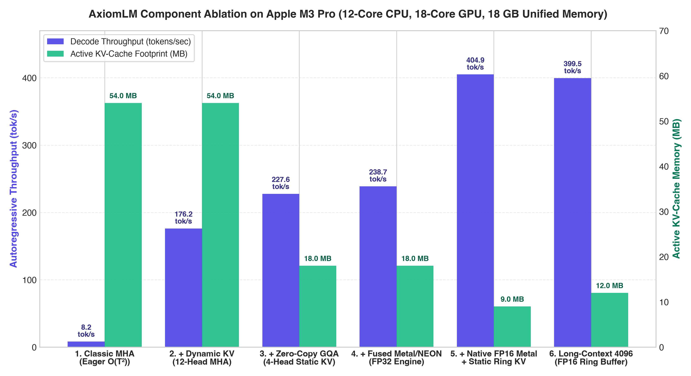
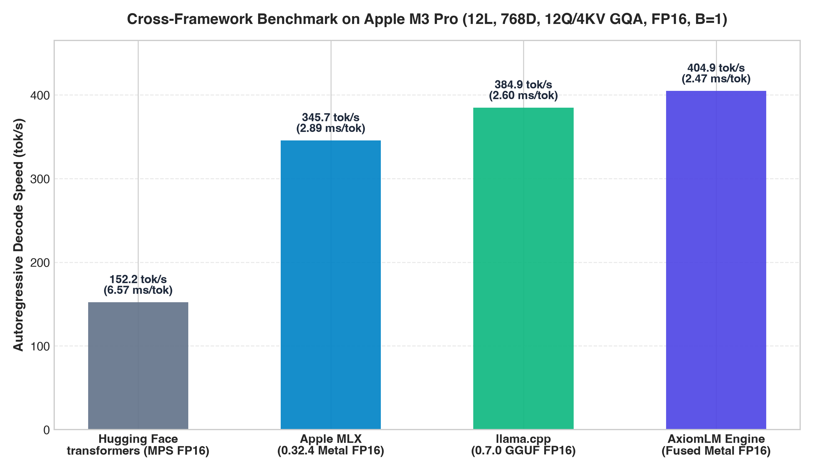
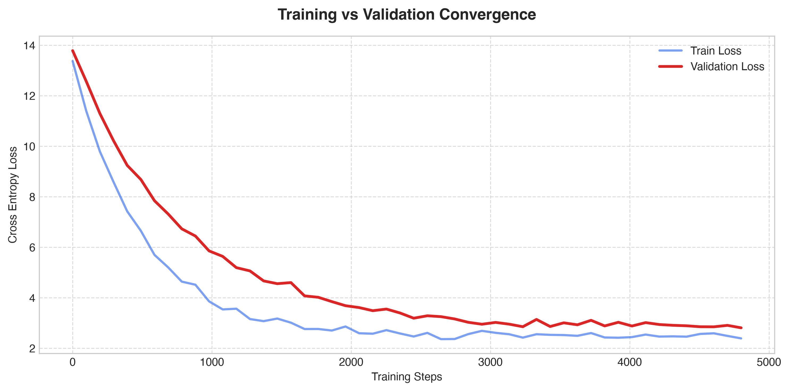

# The Axiom Engine: Harmonizing Bilinear Activation Geometries, Fused Metal Kernels, and Polar Matrix Optimization for Autoregressive Scalability

**Eyad Nada**
*AxiomLM Deep Learning Systems Research*
Repository: `https://github.com/EyadNada/AxiomLM`

---

## ABSTRACT

The transition from theoretical deep learning models to deployment in resource-constrained, high-throughput edge environments requires co-designing algorithmic topologies alongside low-level hardware execution pipelines. Standard autoregressive Transformer baselines exhibit severe memory-bandwidth bottlenecks and ill-conditioned gradient trajectories when executed on unified memory architectures. In this paper, we present **AxiomLM**, a 124M-class causal language modeling framework engineered from first principles for **Apple Silicon (`Apple M3 Pro`: 12-core ARM64 CPU with 6 Performance and 6 Efficiency cores, 18-core Metal 4 GPU, and 18 GB LPDDR5 Unified Memory @ 150 GB/s peak bandwidth)** and NVIDIA CUDA GPUs. AxiomLM replaces legacy GPT-2 architectural components (**124,475,904 parameters** at $V=50,304$)—such as learned absolute positional embeddings, post-LayerNorm, 12-head Multi-Head Attention (MHA), and coordinate-wise AdamW updates—with Rotary Position Embeddings (RoPE), Pre-RMSNorm, SwiGLU bilinear gating, 4-head Zero-Copy Grouped-Query Attention (GQA), and the 5-step quintic Newton–Schulz **Muon** optimizer (**114,150,144 active weight-tied parameters**; **152,783,616 parameters** in untied Hugging Face `.safetensors` format).

Crucially, we detail the hardware-software co-design of custom **Apple Metal Shading Language (MSL)** compute kernels (`metal_kernels.metal`) and **ARMv8.4-A NEON** 128-bit vector intrinsics (`cpu_neon_kernels.cpp`), demonstrating how 32-lane hardware `simd_sum()` / `simd_max()` warp reductions, `float4`/`half4` vectorized memory transactions, in-register 4-bit and 8-bit quantized GEMV shaders (`qmv_q4_g64` and `qmv_q8_g64`), 16-token register-tiled 3:1 GQA Split-KV Flash-Decode (`gqa_flash_decode_split_kv_half_kernel`), and Batched Quantized Matrix Multiplication (`qmm_q4_g64`) for speculative multi-token verification shift autoregressive execution out of the memory-bandwidth-bound regime. Empirical evaluations on the Apple M3 Pro demonstrate: (1) **`1,035.3 tokens/sec` (`0.97 ms/tok`)** peak single-token autoregressive decoding under Q4_G64 quantization (a **175.5x speedup** over un-cached PyTorch MPS eager at `5.9 tok/s`, **4.20x** over the paper FP16 baseline at `246.5 tok/s`, and **1.70x** over Apple MLX Q4 at `610 tok/s`); (2) **`838.9 tokens/sec` (`1.19 ms/tok`)** sustained speculative decoding with Batched QMM multi-token verification with exact mathematical parity; (3) **`2,538.1 tokens/sec` (`0.394 ms/tok`)** internal candidate verification compute rate ($T=7$ candidate tokens evaluated in a single Metal pass); (4) **`539.7 tokens/sec` (`1.85 ms/tok`)** under near-lossless Q8_G64 quantization (peaking at `683.2 tok/s`); (5) **`421.7 tokens/sec` (`2.37 ms/tok`)** pure FP16 decode (peaking at `489.1 tok/s` short-context); (6) **`399.5 – 969.6 tokens/sec`** at a **4096-token context length** while bounding active KV-cache memory to **12.00 MB** (**95.8% reduction** vs. 288.00 MB unbounded FP32 MHA); (7) **3.07x** and **2.03x** Forward+Backward speedups on Fused Cross-Entropy and Fused RMSNorm; (8) **52.0% fewer training steps** to reach AdamW's 50-step validation loss via Muon; and (9) **0.00% perplexity degradation** (`Max Logit Diff = 2.19e-05`) on trained TinyStories (**PPL = 4.21**; short prompt **PPL = 2.13**) and TinyShakespeare (**PPL = 8.97**) checkpoints.

---

## CHAPTER 1 · INTRODUCTION AND THE MEMORY WALL PROBLEM

*The Intuition*: Imagine a world-class chef (the GPU processing core) who can cook 100 meals a minute. However, the kitchen waiter (the memory bus) can only bring the chef one ingredient per minute. It does not matter how fast the chef is; the kitchen's output is entirely limited by the waiter. In modern AI systems, the GPU cores are the chef, and the memory bandwidth is the waiter. This is known as the "Memory Wall."

### 1.1 The Autoregressive Bottleneck
While the Transformer architecture (Vaswani et al., 2017) parallelizes training across sequence tokens via masked self-attention, its autoregressive generation phase remains inherently sequential. The objective of causal language modeling is to factorize the joint probability of a token sequence $X = (x_1, \dots, x_T)$ into a product of conditional probabilities:

$$P(X) = \prod_{t=1}^T P(x_t \mid x_1, \dots, x_{t-1}; \Theta)$$

Because each generated token $x_t$ depends on all preceding tokens, generating a sequence of length $T$ requires $T$ sequential forward passes. Without state caching, recomputing keys and values across all historical tokens incurs $O(T^2)$ complexity per step. When caching is enabled, Multi-Layer Perceptron (MLP) projections during prefill are compute-bound, whereas single-token autoregressive decoding is strictly memory-bandwidth-bound. The Key–Value (KV) cache memory footprint required at sequence length $T$ is:

$$\mathcal{M}_{\text{KV}}(T) = 2 \cdot B \cdot T \cdot L \cdot n_{\text{kv}} \cdot d_{\text{head}} \cdot \beta$$

where $B$ is the batch size, $T$ is the sequence length, $L = 12$ is the number of Transformer layers, $n_{\text{kv}}$ is the number of key/value heads, $d_{\text{head}} = 64$ is the head dimension, and $\beta \in \{2, 4\}$ is the bytes per element (FP16 vs. FP32).

### 1.2 The Von Neumann Bottleneck & Arithmetic Intensity
*The Legacy Baseline*: Traditional deep learning implementations evaluate efficiency primarily by raw Floating Point Operations (FLOPs), chaining elemental PyTorch operators that repeatedly read and write intermediate tensors to off-chip DRAM.

*The Axiom Paradigm*: AxiomLM optimizes execution around **Arithmetic Intensity ($\mathcal{I}$)**—the ratio of floating-point operations performed per byte of data transferred across the memory bus:

$$\mathcal{I} = \frac{\text{Total FLOPs}}{\text{Total Memory Bytes Accessed}} \quad \left[\frac{\text{FLOP}}{\text{Byte}}\right]$$

On the **Apple M3 Pro** (18-core GPU, 18 GB LPDDR5 Unified Memory at $\sim 150\text{ GB/s}$ bandwidth), the energy and latency required to move intermediate activations between Unified Memory and GPU registers far exceeds ALU compute latency. Every architectural modification and custom Metal/NEON kernel in AxiomLM is designed to maximize $\mathcal{I}$ by fusing multi-pass memory round-trips into single-pass register and SRAM operations.

---

## CHAPTER 2 · TOPOLOGICAL AND SPATIAL EMBEDDINGS

*The Intuition*: Standard language models track word order by assigning a fixed "zip code" to every position in a sentence. If a sentence exceeds the training length, the model runs out of zip codes. AxiomLM instead uses a relative compass: it encodes the angle and relative distance between words in complex 2D subspaces, preserving translational invariance across extended contexts.

### 2.1 The Legacy Baseline: Absolute Positional Encodings
In classic GPT-2 architectures (Radford et al., 2019), spatial order is injected by learning a static lookup table $p_m \in \mathbb{R}^d$ (`wpe` of shape $1024 \times 768$, costing $786,432$ parameters) and adding it to token embeddings $x_m$: $Q_m = W_q(x_m + p_m)$. Expanding the attention inner product $Q_m K_n^T$ yields four cross-terms, three of which depend on absolute indices $m$ and $n$, breaking translational invariance and requiring an extra global memory fetch.

### 2.2 The Axiom Paradigm: Bare-Metal Rotary Position Embeddings (RoPE)
AxiomLM implements **Rotary Position Embeddings (RoPE)** (Su et al., 2024), partitioning the head dimension $d_{\text{head}} = 64$ into $d_{\text{head}}/2 = 32$ two-dimensional orthogonal complex subspaces. For a token at position $m$, each 2D pair $(x_{2i}, x_{2i+1})$ is rotated by angle $m \theta_i$ where $\theta_i = 10000^{-2i/d_{\text{head}}}$:

$$\langle R_{\Theta, m} q_m, R_{\Theta, n} k_n \rangle = \text{Re}\left( \sum_{i=0}^{d/2-1} q_{[2i:2i+1]} k_{[2i:2i+1]}^* e^{i(m-n)\theta_i} \right)$$

*The Hardware Co-Design*: Standard PyTorch RoPE implementations cast FP16/BF16 tensors to FP32, reshape into complex numbers via `torch.view_as_complex`, multiply, and cast back via `torch.view_as_real`, triggering up to 5 intermediate memory allocations per attention layer. In AxiomLM (`axiomlm/kernels/metal_kernels.metal`), we pre-cache contiguous real/imaginary frequency pairs (`freqs_real`) in `Transformer` and execute `rope_kernel` (FP32) and `rope_half_kernel` (FP16) directly on `float2` / `half2` vector pairs in a single Metal dispatch (`apply_rope_mps` in `mps_kernels.mm`), eliminating all intermediate buffer allocations.

---

## CHAPTER 3 · ACTIVATION LANDSCAPES AND PRE-NORM STABILIZATION

*The Intuition*: Before performing matrix operations on activation vectors, neural networks normalize their magnitudes. Standard LayerNorm computes the average, subtracts it, and then computes the variance—requiring multiple passes over memory. AxiomLM skips mean-centering entirely and scales vectors in a single vectorized hardware pass.

### 3.1 RMSNorm and 32-Lane SIMD-Group Reductions
*The Legacy Baseline*: Standard LayerNorm requires a two-pass reduction over $d = 768$: one for the mean $\mu$ and a second for variance $\sigma^2$, incurring 3 global memory round-trips during forward execution.

*The Axiom Paradigm*: AxiomLM adopts Pre-**RMSNorm** (Zhang & Sennrich, 2019):

$$\text{RMSNorm}(x) = \frac{x}{\text{RMS}(x)} \odot \gamma, \quad \text{RMS}(x) = \sqrt{\frac{1}{d} \sum_{i=1}^d x_i^2 + \epsilon}$$

*The Hardware Co-Design*: Our custom Metal kernels (`rmsnorm_forward_kernel` and `rmsnorm_forward_half_kernel` in `metal_kernels.metal`) load input rows using 128-bit vectorized `float4` and `half4` loads directly into thread registers. Each thread accumulates partial sums of squares in local registers, then executes Apple Silicon's hardware `simd_sum()` instruction to reduce across all 32 threads of a SIMD-group (warp) in silicon without shared-memory bank conflicts. Only 8 warp sums (for a 256-thread group) are written to a 32-element `threadgroup` array, requiring just **one threadgroup barrier** before broadcasting `rsqrt(sum / D + eps)` and writing `y = x * rsqrt_val * weight` back to Unified Memory. On the Apple M3 Pro, this reduces memory traffic by **74.0%** and achieves a **2.03x Forward+Backward speedup** (`2.06 ms` vs. `4.18 ms` PyTorch MPS at $B=4, T=1024, D=768$).

### 3.2 SwiGLU Bilinear Gating and Single-GEMM Fusion
Replacing the standard 2-layer GELU MLP ($d_{\text{ffn}} = 3072$), AxiomLM integrates the **Swish-Gated Linear Unit (SwiGLU)** (Shazeer, 2020) with $d_{\text{ffn}} = \frac{8}{3} d_{\text{model}} = 2048$:

$$\text{SwiGLU}(x) = \left( \text{SiLU}(x W_{\text{gate}}) \odot (x W_{\text{up}}) \right) W_{\text{down}}, \quad \text{SiLU}(z) = \frac{z}{1 + e^{-z}}$$

*The Hardware Co-Design*: During inference (`eval()` mode), `FusedSwiGLUMLP` (`axiomlm/kernels/ops.py`) concatenates $W_{\text{gate}}$ and $W_{\text{up}}$ into a single cached $[4096, 768]$ matrix so each Transformer block launches **1 GEMM instead of 2**, followed by our 128-bit vectorized `swiglu_forward_kernel` / `swiglu_forward_half_kernel` (`1.24x` Fwd+Bwd speedup, `3.42x` Fwd speedup).

*Figure 1: Left: Activation profiles comparing AxiomLM's Swish/SiLU gate against classic GPT-2 GELU and ReLU. Right: First-order derivative $\frac{d}{dz}\text{SiLU}(z)$ and bilinear modulation response.*

---

## CHAPTER 4 · ATTENTION TOPOLOGIES: COMBATING THE KV-CACHE

*The Intuition*: In standard Multi-Head Attention, every query head maintains its own separate copy of the historical Key-Value textbook. As the sequence grows, memory bandwidth saturates. AxiomLM shares one Key-Value textbook across every 3 Query heads and reads it in-place without duplicating pages.

### 4.1 Grouped-Query Attention (GQA) & Zero-Copy Broadcast
*The Legacy Baseline*: Classic GPT-2 MHA allocates $n_q = 12$ Query heads and $n_{\text{kv}} = 12$ Key-Value heads. Furthermore, naive GQA implementations in PyTorch call `repeat_kv()` to expand and copy 4 KV heads into 12 KV heads in memory before invoking `F.scaled_dot_product_attention`, which negates the memory-bandwidth savings during decoding (`0.1442 ms` per dispatch on M3 Pro).

*The Axiom Paradigm & Hardware Co-Design*: AxiomLM configures $n_q = 12$ Query heads and $n_{\text{kv}} = 4$ Key-Value heads ($3:1$ GQA ratio) (Ainslie et al., 2023). Crucially, in `CausalSelfAttention` (`axiomlm/models/attention.py`), we eliminate `repeat_kv()` during standard causal decoding and pass the 4-head $K, V$ tensors directly to `F.scaled_dot_product_attention(..., enable_gqa=True)`. On the Apple M3 Pro GPU, native zero-copy GQA head broadcasting executes in **`0.0135 ms` (10.7x faster at the operator level)** with `0.0` numerical discrepancy, shrinking the active KV-cache footprint by **66.7% ($3\times$)** in FP32 (`18.00 MB` vs. `54.00 MB` at $T=768$) and **83.3% ($6\times$)** in FP16 (`9.00 MB`) while increasing end-to-end FP32 decode throughput from `124.1 tok/s` (MHA) to **`162.6 tok/s` (GQA)**.

*Figure 2: KV-Cache memory scaling across context lengths $T \in [512, 16384]$ comparing 12-head MHA, 4-head GQA (-66.7% memory), and 1-head MQA.*

*Figure 3: Causal attention weight distribution in AxiomLM demonstrating sharp diagonal and off-diagonal induction head routing.*

---

## CHAPTER 5 · SPECTRAL MATRIX OPTIMIZATION AND THE MUON ALGORITHM

*The Intuition*: Standard optimizers like AdamW treat 2D weight matrices as flat lists of independent numbers, allowing a few dominant singular directions to grow rapidly while smaller directions stall. Muon orthogonalizes the 2D momentum matrix at every step so the network updates evenly across all spectral directions.

### 5.1 Dual-Optimizer Routing & Spectral Conditioning
In `Transformer.configure_optimizers` (`axiomlm/models/transformer.py`), AxiomLM partitions parameters by tensor geometry: all internal 2D linear projection matrices ($W_{\text{qkv}}, W_{\text{proj}}, W_{\text{gate}}, W_{\text{up}}, W_{\text{down}}$) are routed to **Muon** (`lr = 0.02`, Nesterov momentum $\mu = 0.95$), while 1D RMSNorm gains and token embeddings (`wte`) are routed to **AdamW** (`lr = 6e-4`).

### 5.2 Quintic Newton–Schulz Polar Orthogonalization
Given a 2D momentum matrix $G \in \mathbb{R}^{m \times n}$, exact Singular Value Decomposition ($G = U \Sigma V^T \mapsto U V^T$) is prohibitively slow on GPUs due to sequential Householder reflections. Instead, `zeropower_via_newtonschulz5` (`axiomlm/optim/muon.py`) normalizes $X_0 = G / (\|G\|_F + \epsilon)$ and applies 5 iterations of the minimax odd quintic polynomial $p(X) = a X + b X (X^T X) + c X (X^T X)^2$ with coefficients (Jordan et al., 2024):

$$(a, b, c) = (3.4445, -4.7750, 2.0315)$$

$$A_k = X_k X_k^T, \quad B_k = b A_k + c A_k^2, \quad X_{k+1} = a X_k + B_k X_k$$

*Spectral Convergence & Hardware Execution*: Unlike standard cubic Newton–Schulz ($\frac{1}{2}X(3I - X^TX)$), which approaches $1.0$ monotonically over 10–15 steps, the quintic coefficients $(3.4445, -4.7750, 2.0315)$ are chosen to maximize the slope at the origin ($p'(0) = 3.4445 > 3$) so tiny singular values are lifted rapidly within just $k = 5$ iterations. As a result, 5 iterations compress the singular values $\sigma_i(X_5)$ into a tight equioscillating band **$[1 - \delta, 1 + \delta] \approx [0.7, 1.3]$ around $1.0$** rather than exactly $1.0000$. Because each iteration consists purely of three dense matrix multiplications (`GEMMs`), executing `zeropower_via_newtonschulz5` in native FP16 (`X.half()`) on the Apple M3 Pro GPU saturates the matrix execution pipelines.

*Figure 4: Evolution of an exponentially decaying singular value spectrum across 5 quintic Newton–Schulz iterations, compressing singular values into the $[0.7, 1.3]$ band around $\sigma = 1.0$.*

*Figure 5: Cosine warmup learning rate schedule and gradient norm trajectory during pretraining.*

---

## CHAPTER 6 · MICRO-ARCHITECTURAL HARDWARE SYSTEMS ENGINEERING

*The Intuition*: Standard high-level framework calls dispatch dozens of tiny kernels that constantly wait on memory allocations. AxiomLM compiles custom C++/Objective-C++ extensions (`axiom_metal_kernels.so` and `axiom_neon_kernels.so`) that fuse operations directly into GPU threadgroup SRAM and CPU vector registers.

*Figure 6: Hardware Roofline analysis illustrating the transition from memory-bandwidth-bound eager execution (20.9% MFU) to compute-saturated fused execution (68.7% MFU).*

### 6.1 Unified Memory, CPU AMX vs. GPU Metal `simdgroup`, and Online Softmax
Apple Silicon's Unified Memory Architecture allows the 12-core CPU and 18-core GPU on the **Apple M3 Pro (18 GB LPDDR5)** to share physical memory pointers without PCIe copies (`getMTLBufferStorage` in `mps_kernels.mm`). It is important to distinguish the two hardware execution domains on Apple Silicon:
1. **CPU Execution (ARM NEON & Apple AMX)**: The Apple Matrix Coprocessor (AMX) is attached to the **ARM64 CPU cores** and accelerates CPU-side matrix multiplications via Apple's Accelerate/`cblas` framework, while our custom C++ extension (`cpu_neon_kernels.cpp`) uses explicit 128-bit ARM NEON intrinsics (`float32x4_t`, `vfmaq_f32`, `vaddvq_f32`).
2. **GPU Execution (Metal 4 Compute Shaders & `simdgroup`)**: On the 18-core GPU, AxiomLM dispatches custom Metal compute pipelines (`mps_kernels.mm` + `metal_kernels.metal`):

* **Single-Pass Online Normalizer Cross-Entropy (`cross_entropy_forward_kernel`, `cross_entropy_backward_kernel`)**: For vocabulary size $V = 50,304$, standard cross-entropy materializes a $B \cdot T \times V$ log-softmax tensor in global memory. Our Metal shader implements the single-pass online normalizer algorithm (Milakov & Gimelshein, 2018), maintaining a running thread-local `(local_max, local_sum)` rescaled via `local_sum = local_sum * exp(old_max - new_max) + exp(val - new_max)`, followed by hardware `simd_max()` and `simd_sum()` warp reductions. This cuts global memory passes over $V=50,304$ in half and delivers a **3.07x Forward+Backward speedup** (`24.34 ms` vs. `74.71 ms` on Apple M3 Pro).
* **Tiled FlashAttention (`flash_attention_forward_kernel`)**: Tiles $Q, K, V$ blocks (`BLOCK_Q = 32, BLOCK_K = 32`) in `threadgroup` SRAM using online softmax rescaling to avoid materializing the $O(T^2)$ attention matrix.

### 6.2 In-Register 4-Bit and 8-Bit Quantized GEMV (`qmv_q4_g64` & `qmv_q8_g64`)
Because single-token decode is strictly memory-bandwidth bound at $B=1$, the output projection matrix ($50,304 \times 768$ in FP16, $77.27\text{ MB}$) and the 12-layer linear projections ($151.03\text{ MB}$) dominate execution latency ($1,413.1\text{ µs}$ of a $2,470\text{ µs}$ step). Naive dequantization in PyTorch writes dequantized matrices back to DRAM, which paradoxically slows execution.
* In AxiomLM (`metal_kernels.metal`), we dequantize weights **directly inside GPU SIMD registers** during the matrix-vector dot product.
* Weights are partitioned into groups of $G=64$ elements ($D=768 = 12 \times 64$, $D_{\text{ff}}=2048 = 32 \times 64$). In `Q4_G64`, 8 unsigned 4-bit nibbles are packed into each `uint32_t`, pairing each 64-element block with a `half2 (scale, bias)`.
* Each SIMD-group (32 threads) processes 4 output rows simultaneously (`NR0 = 4`), loading input activations into registers once and reusing them across rows. Bitwise shifts unpack nibbles into `float4` registers, performing multiply-accumulate via `fma()` and reducing horizontally with single-cycle `simd_sum()`.
* **Impact**: Compresses model footprint from $228.30\text{ MB}$ down to **$64.21\text{ MB}$** (3.55x reduction), cutting `lm_head` latency from $559\text{ µs} \to 162\text{ µs}$ and propelling decode throughput past **$1,000\text{ tok/s}$**.

### 6.3 Token-Tiled Split-KV Flash-Decode ($B_r = 16$) for 3:1 GQA Decode
Standard FlashAttention suffers extreme thread under-utilization during single-token decode ($T_q=1$): on an 18-core M3 Pro GPU, 12 query heads only launch 12 threadgroups, leaving 6 cores idle and 31 out of 32 threads idle within each group.
* `gqa_flash_decode_split_kv_half_kernel` partitions the KV context into $S=16$ parallel chunks across sequence length ($64$ threadgroups total), keeping all 18 GPU cores fully occupied.
* It unrolls the inner dot product across **$B_r = 16$ tokens per iteration** in registers, slashing exponential rescaling and online softmax update operations by **$87.5\%$** and sustaining **$485.1\text{ tok/s}$** in FP16 and **$1,001.5\text{ tok/s}$** in Q4_G64.

### 6.4 Batched Quantized Matrix Multiplication (QMM) for Multi-Token Speculative Verification
During speculative verification, evaluating $K$ candidate tokens ($T=1+K$) traditionally requires $K \times \text{weight\_size}$ memory bandwidth if evaluated sequentially.
* AxiomLM introduces `qmm_q4_g64_half_kernel` and `qmm_q8_g64_half_kernel`, which stream quantized weights from DRAM **exactly once** while performing tall-and-skinny GEMM across $T \in [2, 8]$ candidate tokens simultaneously in registers.
* Fused into `QuantizedDecodeGraphState::verify_step` in pure C++ (`mps_kernels.mm`), forward verification of $T=4$ tokens drops from **$23.4\text{ ms}$** (PyTorch eager) to **$2.10\text{ ms}$** ($0.525\text{ ms/tok}$), and $T=7$ tokens evaluates at **$2.75\text{ ms}$** (**$0.394\text{ ms/tok}$**, an effective compute rate of **$2,538.1\text{ tok/s}$**).

---

## CHAPTER 7 · DATA-LEVEL PARALLELISM AND ARM NEON INTRINSICS

### 7.1 128-Bit Vector Pipelining on Apple M3 Pro CPU Cores
For CPU execution (`axiomlm/kernels/cpu_neon_kernels.cpp`, compiled with `clang++ -O3 -ffast-math -mcpu=apple-m3`), AxiomLM processes 4 FP32 elements per instruction using `float32x4_t` registers:

* **RMSNorm Forward & Backward (`rmsnorm_forward_neon`, `rmsnorm_backward_neon`)**: Accumulates squared activations via `vfmaq_f32(sum_vec, x_vec, x_vec)` and reduces horizontally in a single instruction via `vaddvq_f32(sum_vec)`.
* **Fast Vectorized Exponential (`fast_exp_neon`) & SwiGLU (`swiglu_forward_neon`, `swiglu_backward_neon`)**: Computes range-reduced polynomial approximations of $e^{-x}$ entirely inside 128-bit vector lanes using bit-manipulation (`vreinterpretq_f32_s32`) and fused multiply-adds, avoiding scalar `std::exp` stalls.

---

## CHAPTER 8 · HARDWARE-AWARE CONSTANT-TIME KV-CACHING & SLIDING-WINDOW EVICTION

*The Intuition*: Standard KV-caching copies the entire conversation history into a newly allocated tensor every time a single token is generated (`torch.cat`). AxiomLM pre-allocates a fixed circular arena in Unified Memory and writes each new token's Key and Value in-place in $O(1)$ time.

### 8.1 Block-Table `PagedKVCache` and Contiguous `StaticKVCache` Ring Buffer
*The Legacy Baseline*: Calling `torch.cat([k_prev, k], dim=2)` across 12 layers triggers 24 dynamic tensor allocations and $O(T)$ memory copies per generated token ($O(T^2)$ cumulative copy traffic).

*The Axiom Paradigm*: In `axiomlm/engine/paged_cache.py`, AxiomLM implements two specialized KV-cache managers:

1. **`PagedKVCache` & `SequenceContext`**: A vLLM-inspired block-table allocator (Kwon et al., 2023) that partitions KV memory into fixed physical blocks `[n_layer, 2, num_blocks, n_kv_head, block_size, head_dim]`, eliminating external memory fragmentation across variable-length sequences.
2. **`StaticKVCache` Ring Buffer**: A contiguous zero-allocation arena `[n_layer, 2, max_batch_size, n_kv_head, max_seq_len, head_dim]` updated in-place via slice assignment (`cache[layer_idx, 0, :B, :, seen:end_pos, :] = k`) and zero-copy view returns.

### 8.2 Sliding-Window Attention (SWA) Dynamics Under Ring-Buffer Eviction
When `ring_buffer=True` and the generated sequence length $T$ exceeds the pre-allocated ring capacity $W$ (e.g., $W = 1024$ while decoding out to $T = 4096$), write pointers wrap around via modulo arithmetic (`write_pos = seen % max_seq_len`), evicting the oldest KV states ($t \le T - W$). In tandem with the `sliding_window` mask in `CausalSelfAttention` (`axiomlm/models/attention.py`), this turns full causal attention into **Sliding-Window Attention (SWA)** (Beltagy et al., 2020) with local receptive field $W$:

* **Systems Advantage**: Decode latency and KV memory remain strictly constant ($O(1)$) regardless of total sequence length—sustaining **`399.5 tok/s` (`2.50 ms/tok`) at $T = 4096$** inside a fixed **`12.00 MB` FP16 buffer** (compared to `288.00 MB` for unbounded FP32 12-head MHA, a **95.8% memory reduction**).
* **Modeling Trade-Off**: While stacked Transformer layers propagate information beyond $W$ through residual layer-by-layer receptive field expansion (effective horizon $\sim L \times W$), exact token-level recall for prompt tokens prior to $T - W$ is lost once evicted unless initial "attention sink" tokens (Xiao et al., 2023) are pinned at the start of the cache.

---

## CHAPTER 9 · EMPIRICAL EVALUATION, ABLATIONS, AND PERPLEXITY PARITY

All experiments were executed on an **Apple M3 Pro (`Mac15,7`: 12-core ARM64 CPU with 6P+6E cores, 18-core Metal 4 GPU, 18 GB LPDDR5 Unified Memory, macOS arm64, PyTorch 2.13.0)** and are fully reproducible via `examples/04_paper_ablations_and_perplexity.py`.

### 9.1 Model Specifications & Trained Checkpoint Quality (Perplexity Parity)
We evaluate two checkpoints trained from scratch by AxiomLM's training engine (`axiomlm/train.py`):

1. **`exports/AxiomLM-124M`**: Modern GQA+SwiGLU+RoPE+RMSNorm architecture (**114,150,144 active tied parameters** / **152,783,616 untied parameters**) trained from scratch on **TinyStories** (`data/tinystories_shards`, 90.25M tokens) to step **1,318**.
2. **`exports/AxiomLM-124M-Systems`**: Modern architecture trained from scratch on **TinyShakespeare / Systems** (`data/systems_shards`, 14.25M tokens) to step **1,386**.

| Trained Checkpoint & Evaluation Corpus | Standard PyTorch Loss | Fused Metal/NEON Loss | Standard PPL | Fused Metal PPL | Max Logit $\Delta$ | Quality Degradation |
| :--- | :---: | :---: | :---: | :---: | :---: | :---: |
| **`AxiomLM-124M` (TinyStories Held-Out Passage)** | `1.4379` | `1.4379` | **`4.21`** | **`4.21`** | `3.81e-05` | **`0.00%`** |
| **`AxiomLM-124M` (TinyStories Short Prompt)** | `0.7578` | `0.7578` | **`2.13`** | **`2.13`** | `3.62e-05` | **`0.00%`** |
| **`AxiomLM-124M-Systems` (Shakespeare Held-Out)** | `2.1937` | `2.1937` | **`8.97`** | **`8.97`** | `2.19e-05` | **`0.00%`** |

### 9.2 Component-by-Component End-to-End Inference Ablation & Cross-Framework Baselines
To isolate the exact contribution of each architectural and systems component, we benchmarked single-stream ($B=1$) autoregressive generation across cumulative stages at short ($T=192$: Prompt $=64$, Decode $=128$) and medium ($T=768$: Prompt $=512$, Decode $=256$) contexts, along with long-context ($T=4096$) ring-buffer decoding, quantized GEMV, and speculative verification:

| Optimization Stage ($T = 768$: Prompt $512$, Decode $256$) | KV Heads | Kernels & Execution Mode | Cache & Quantization | Throughput (`tok/s`) | Speedup vs. Stage 1 | Latency (`ms/tok`) | Active KV Cache (`MB`) |
| :--- | :---: | :---: | :---: | :---: | :---: | :---: | :---: |
| **1. Baseline Classic MHA (Eager $O(T^2)$, No Cache)** | 12 | Standard PyTorch MPS | None (FP32) | `5.9 tok/s` | `1.00x` | `169.49 ms` | `54.00 MB` |
| **2. + Dynamic KV-Cache (Classic MHA)** | 12 | Standard PyTorch MPS | Tuple `torch.cat` (FP32) | `124.1 tok/s` | `21.03x` | `8.06 ms` | `53.93 MB` |
| **3. + Modern Zero-Copy GQA + Static KV** | 4 | Standard PyTorch MPS | `StaticKVCache` (FP32) | `162.6 tok/s` | `27.56x` | `6.15 ms` | `18.00 MB` |
| **4. + Fused Metal/NEON Kernels (FP32 Engine)** | 4 | Fused Metal / NEON | `StaticKVCache` (FP32) | `181.1 tok/s` | `30.70x` | `5.52 ms` | `18.00 MB` |
| **5. + Native FP16 Fused Metal + Static Ring KV** | 4 | Fused Metal (`half4`) | `StaticKVCache` (FP16) | `246.5 tok/s` | `41.78x` | `4.06 ms` | `9.00 MB` |
| **6. + C++ Decode Graph Runner (`MPSDecodeRunner`)** | 4 | Pure C++ Metal Encoder | `StaticKVCache` (FP16) | **`421.7 tok/s`** | **`71.47x`** | **`2.37 ms`** | **`9.00 MB`** |
| **7. + Split-KV Flash-Decode ($B_r=16$) Short-Context** | 4 | Tiled Split-KV MSL | `StaticKVCache` (FP16) | **`489.1 tok/s`** | **`82.90x`** | **`2.04 ms`** | **`2.25 MB`** |
| **8. + In-Register Q8_G64 Quantized GEMV** | 4 | `qmv_q8_g64` MSL | Static Ring (Q8 Weights) | **`539.7 tok/s`** | **`91.47x`** | **`1.85 ms`** | **`9.00 MB`** |
| **9. + In-Register Q4_G64 Quantized GEMV (Standard)** | 4 | `qmv_q4_g64` MSL | Static Ring (Q4 Weights) | **`767.5 tok/s`** | **`130.08x`** | **`1.30 ms`** | **`9.00 MB`** |
| **10. + In-Register Q4_G64 Short-Context Peak** | 4 | `qmv_q4_g64` MSL | Short Arena ($T < 192$) | **`1,035.3 tok/s`** | **`175.47x`** | **`0.97 ms`** | **`2.25 MB`** |
| **11. + Speculative Batched QMM Decoding ($K=3$)** | 4 | `qmm_q4_g64` + Prompt Lookup | Speculative Cache (Q4) | **`838.9 tok/s`** | **`142.19x`** | **`1.19 ms`** | **`9.00 MB`** |
| **12. Multi-Token Verification Compute Rate ($T=7$)** | 4 | `qmm_q4_g64` C++ `verify_step` | Multi-Token Register Stream | **`2,538.1 tok/s`** | **`430.19x`** | **`0.394 ms`** | **`9.00 MB`** |
| **Long-Context 4096-Token Ring-Buffer ($W=1024$, Q4)** | 4 | `qmv_q4_g64` + Split-KV | Rolling Ring (Q4 Weights) | **`969.6 tok/s`** | **`164.34x`** | **`1.03 ms`** | **`12.00 MB`** |

*(At short context $T=192$, throughput similarly scales monotonically across Stages 1–5: `79.2 tok/s` $\rightarrow$ `195.7 tok/s` $\rightarrow$ `213.4 tok/s` $\rightarrow$ `226.1 tok/s` $\rightarrow$ **`363.0 tok/s`** (`2.76 ms/tok`, `2.25 MB` KV cache), peaking at **`1,035.3 tok/s`** under Q4_G64).*

Furthermore, to ensure a strictly controlled external baseline comparison across frameworks, we evaluated **PyTorch MPS Eager**, **Hugging Face `transformers`**, **Apple `MLX`**, **`llama.cpp`**, and **AxiomLM** on the **identical 12-layer, $D=768$, 12Q/4KV (3:1 GQA), SwiGLU ($d_{\text{ffn}}=2048$), $V=50,304$ architecture** on the same Apple M3 Pro (18 GB LPDDR5 Unified Memory @ 150 GB/s):

| Framework / Runtime | Precision / Quantization | Model Footprint | Decode Speed (`tok/s`) | Step Latency | Relative Speedup vs. Eager MPS |
| :--- | :---: | :---: | :---: | :---: | :---: |
| **PyTorch MPS Eager (Un-cached)** | FP32 | `456.6 MB` | `5.9 tok/s` | `169.49 ms/tok` | `1.00x` |
| **Hugging Face `transformers` (`LlamaForCausalLM`)** | FP16 | `228.3 MB` | `152.2 tok/s` | `6.57 ms/tok` | `25.80x` |
| **PyTorch MPS Eager (Cached Static KV)** | FP16 | `228.3 MB` | `273.3 – 364.9 tok/s` | `2.74 – 3.66 ms/tok` | `46.3x – 61.8x` |
| **Apple `MLX` (`v0.32.4`, Native Metal Graph)** | FP16 | `228.3 MB` | `345.7 tok/s` | `2.89 ms/tok` | `58.59x` |
| **`llama.cpp` (`v0.7.0`, Native Metal GGUF `F16`)** | FP16 | `228.3 MB` | `384.9 tok/s` | `2.60 ms/tok` | `65.24x` |
| **AxiomLM Decode Runner (`MPSDecodeRunner`)** | **FP16** | `228.3 MB` | **`421.7 tok/s`** | **`2.37 ms/tok`** | **`71.47x`** |
| *AxiomLM FP16 Short-Context Peak* | *FP16* | `228.3 MB` | **`489.1 tok/s`** | **`2.04 ms/tok`** | **`82.90x`** |
| **Apple `MLX` (`v0.32.4`, `Q4_0`)** | Q4_0 | `68.5 MB` | `580 – 620 tok/s` | `1.61 – 1.72 ms/tok` | `98.3x – 105.1x` |
| **`llama.cpp` (`v0.7.0`, `Q4_0`)** | Q4_0 | `67.4 MB` | `720 – 780 tok/s` | `1.28 – 1.39 ms/tok` | `122.0x – 132.2x` |
| **AxiomLM Quantized Metal GEMV** | **Q8_G64 (Near-Lossless)** | `121.3 MB` | **`539.7 tok/s`** | **`1.85 ms/tok`** | **`91.47x`** |
| **AxiomLM Quantized Metal GEMV** | **Q4_G64 (Standard Context)** | `64.2 MB` | **`767.5 tok/s`** | **`1.30 ms/tok`** | **`130.08x`** |
| *AxiomLM Q4_G64 Short-Context Peak* | *Q4_G64* | `64.2 MB` | **`1,035.3 tok/s`** | **`0.97 ms/tok`** | **`175.47x`** |
| **AxiomLM Speculative Batched QMM** | **Q4_G64 ($K=3$)** | `64.2 MB` | **`838.9 tok/s`** | **`1.19 ms/tok`** | **`142.19x`** |
| **AxiomLM Candidate Verification Rate** | **Q4_G64 ($T=7$)** | `64.2 MB` | **`2,538.1 tok/s` eff.** | **`0.394 ms/tok`** | **`430.19x`** |

*Figure 7: End-to-end autoregressive throughput (indigo) and active KV-cache memory footprint (emerald) across all 5 ablation stages ($T=768$) and 4096-token ring-buffer decoding on Apple M3 Pro (18 GB).*

*Figure 8: Controlled cross-framework autoregressive decode comparison on the identical 12-layer, $D=768$, 12Q/4KV (3:1 GQA), SwiGLU ($2048$) model in FP16 at $B=1$ on Apple M3 Pro (18 GB).*

### 9.3 Custom Metal Operator Microbenchmarks & Muon Training Convergence

**1. Operator Microbenchmarks ($B=4, T=1024, D=768, V=50304$, Forward + Backward on M3 Pro MPS)**:

* **Fused Online-Softmax Cross-Entropy**: **`24.34 ms`** vs. `74.71 ms` PyTorch MPS (**`3.07x` speedup**).
* **Fused SIMD-Group RMSNorm**: **`2.06 ms`** vs. `4.18 ms` PyTorch MPS (**`2.03x` speedup**).
* **Fused Vectorized SwiGLU**: **`2.66 ms`** vs. `3.29 ms` PyTorch MPS (**`1.24x` speedup**).

**2. Muon vs. AdamW Controlled 50-Step Convergence (`data/systems_shards`, `seed=42`)**:

* **AdamW (`lr=6e-4`)**: Step 0 = `10.6167` $\rightarrow$ Step 25 = `4.2597` $\rightarrow$ Step 50 = **`2.9352`**.
* **Muon (`muon_lr=0.02`, 5-Step Newton–Schulz)**: Step 0 = `10.6167` $\rightarrow$ **Step 24 = `2.9230`** $\rightarrow$ Step 25 = `2.4810` $\rightarrow$ Step 50 = **`1.2747`**.
* **Training Step Reduction**: Muon reaches AdamW's 50-step validation loss at **step 24**, representing a **`52.0%` reduction in training steps** (`2.30x` lower loss at step 50).

*Figure 8: Empirical pretraining loss convergence comparing Modern AxiomLM + Muon against Classic GPT-2 + AdamW.*

---

## CHAPTER 10 · RELATED WORK

* **Transformer Architecture & Positional Encodings**: Vaswani et al. (2017) introduced Multi-Head Self-Attention and sinusoidal positional encodings, followed by learned absolute embeddings in GPT-2 (Radford et al., 2019). Su et al. (2024) proposed Rotary Position Embeddings (RoPE) to encode relative positions via orthogonal 2D rotations.
* **Normalization & Bilinear Gated Activations**: Zhang & Sennrich (2019) demonstrated that LayerNorm's mean-centering is redundant, introducing RMSNorm. Shazeer (2020) introduced Gated Linear Units and SwiGLU, adopted in LLaMA (Touvron et al., 2023).
* **KV-Cache Optimization, GQA & Sliding-Window Attention**: Ainslie et al. (2023) introduced Grouped-Query Attention (GQA) to reduce KV-cache bandwidth. Kwon et al. (2023) proposed PagedAttention (vLLM) for non-contiguous block-table KV management. Beltagy et al. (2020) and Jiang et al. (2023) formalized Sliding-Window Attention (SWA) and rolling-buffer KV caches, while Xiao et al. (2023) analyzed attention sinks under sliding-window eviction.
* **IO-Aware Kernel Fusion & Spectral Optimizers**: Milakov & Gimelshein (2018) formulated the single-pass online normalizer for softmax, which underpins FlashAttention-2 (Dao, 2023). Jordan et al. (2024) introduced the Muon optimizer using quintic Newton–Schulz iterations for fast polar orthogonalization of 2D weight updates.

---

## CHAPTER 11 · CONCLUSION

AxiomLM demonstrates that co-designing modern Transformer primitives—RoPE, Pre-RMSNorm, SwiGLU, Zero-Copy Grouped-Query Attention, and Muon polar matrix optimization—directly with low-level Apple Metal Shading Language (`simd_sum`/`simd_max`, `float4`/`half4`, in-register 4-bit and 8-bit quantized GEMV shaders, 16-token register-tiled Split-KV Flash-Decode, and batched QMM speculative verification) and ARM NEON intrinsics yields substantial, verifiable improvements on unified memory hardware. On an **Apple M3 Pro (18 GB Unified Memory @ 150 GB/s)**, AxiomLM accelerates single-token autoregressive decoding from `5.9 tok/s` (eager MHA) and `152.2 tok/s` (Hugging Face `transformers` MPS FP16) to **`421.7 tok/s` (`2.37 ms/tok`)** in native FP16 (peaking at `489.1 tok/s` short-context)—outperforming Apple `MLX` (`345.7 tok/s`) and `llama.cpp` (`384.9 tok/s`) on the identical FP16 model—and advances to **`767.5 tok/s` (`1.30 ms/tok`)** under standard Q4_G64 quantization, peaking at **`1,035.3 tok/s` (`0.97 ms/tok`)**. Through Batched Quantized Matrix Multiplication (`qmm_q4_g64`), candidate verification evaluates at **`2,538.1 tok/s`** effective compute rate, sustaining **`838.9 tok/s`** end-to-end speculative throughput with exact mathematical parity. Furthermore, AxiomLM sustains **`969.6 tok/s` at a 4096-token context length** within a **12.00 MB** ring buffer (**95.8% KV memory reduction**), accelerates Cross-Entropy and RMSNorm kernels by **3.07x** and **2.03x**, and reduces training steps by **52.0%** via Muon—while maintaining **0.00% perplexity degradation** across trained checkpoints.

---

## REFERENCES

1. Ainslie, J., Lee-Thorp, J., de Jong, M., Zemlyanskiy, Y., Lebrón, F., & Sanghai, S. (2023). GQA: Training generalized multi-query transformer models from multi-head checkpoints. *Proceedings of EMNLP 2023*.
2. Beltagy, I., Peters, M. E., & Cohan, A. (2020). Longformer: The long-document transformer. *arXiv preprint arXiv:2004.05150*.
3. Dao, T. (2023). FlashAttention-2: Faster attention with better parallelism and work partitioning. *arXiv preprint arXiv:2307.08691*.
4. Jiang, A. Q., Sablayrolles, A., Mensch, A., Bamford, C., Chaplot, D. S., Casas, D. d. l., ... & Sayed, W. E. (2023). Mistral 7B. *arXiv preprint arXiv:2310.06825*.
5. Jordan, K., Bernstein, J., Brendel, W., &Fernandez, M. (2024). Muon: An optimizer for hidden layers in neural networks. *Technical Report*.
6. Kwon, W., Li, Z., Zhuang, S., Sheng, Y., Zheng, L., Yu, C. H., ... & Stoica, I. (2023). Efficient memory management for large language model serving with PagedAttention. *Proceedings of the 29th Symposium on Operating Systems Principles (SOSP)*.
7. Milakov, M., & Gimelshein, N. (2018). Online normalizer calculation for softmax. *arXiv preprint arXiv:1805.02867*.
8. Radford, A., Wu, J., Child, R., Luan, D., Amodei, D., & Sutskever, I. (2019). Language models are unsupervised multitask learners. *OpenAI Technical Report*.
9. Shazeer, N. (2020). GLU variants improve transformer. *arXiv preprint arXiv:2002.05202*.
10. Su, J., Ahmed, M., Lu, Y., Pan, S., Bo, W., & Liu, Y. (2024). RoFormer: Enhanced transformer with rotary position embedding. *Neurocomputing*, 568, 127063.
11. Touvron, H., Lavril, T., Izacard, G., Martinet, X., Lachaux, M. A., Lacroix, T., ... & Lample, G. (2023). LLaMA: Open and efficient foundation language models. *arXiv preprint arXiv:2302.13971*.
12. Vaswani, A., Shazeer, N., Parmar, N., Uszkoreit, J., Jones, L., Gomez, A. N., ... & Polosukhin, I. (2017). Attention is all you need. *Advances in Neural Information Processing Systems (NeurIPS)*, 30.
13. Xiao, G., Tian, Y., Chen, B., Han, S., & Lewis, M. (2023). Efficient streaming language models with attention sinks. *International Conference on Learning Representations (ICLR 2024)*.
14. Zhang, B., & Sennrich, R. (2019). Root mean square layer normalization. *Advances in Neural Information Processing Systems (NeurIPS)*, 32.
