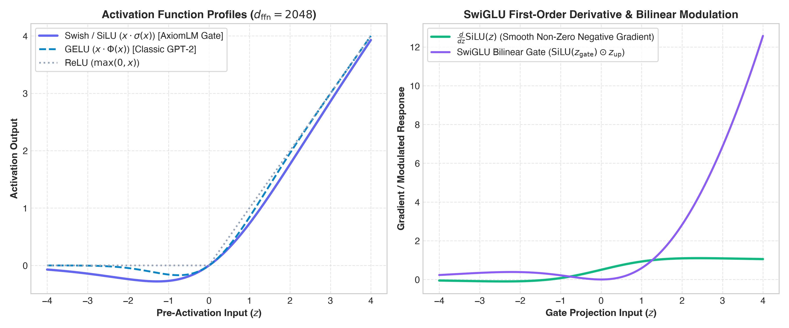
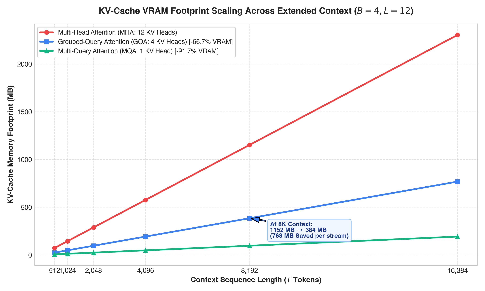
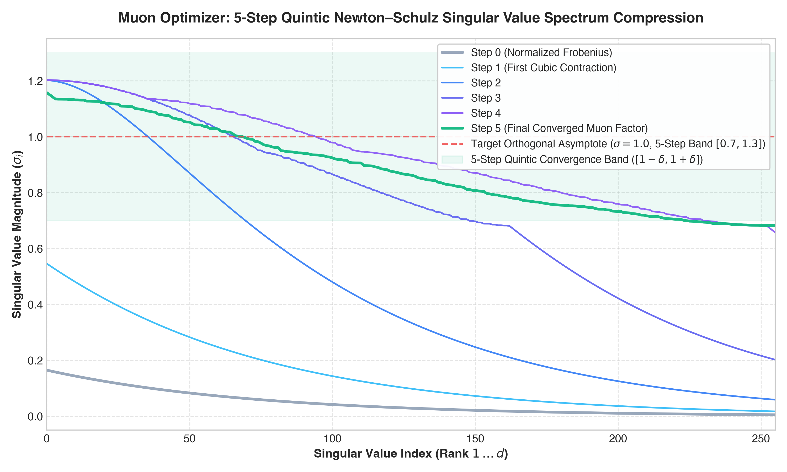

# AxiomLM: High-Performance Autoregressive Language Modeling with Modern Architectures and Polar Matrix Optimization

**Technical Report & Architectural Whitepaper**
*AxiomLM Engineering & Deep Learning Systems Research*

[Download Complete Paper Draft (PDF) :octicons-file-badge-16:](assets/AxiomLM_Research_Paper_Draft.pdf){ .md-button .md-button--primary }

---

## 1. Executive Summary

**AxiomLM** is a 124M-class causal language model and bare-metal execution framework engineered to bridge the gap between modern Transformer architectures and low-level hardware execution on **Apple Silicon (`Apple M3 Pro`: 12-Core ARM64 CPU with 6 Performance + 6 Efficiency cores, 18-Core Metal 4 GPU, 18 GB LPDDR5 Unified Memory)** and NVIDIA CUDA GPUs. While classic autoregressive baselines (such as GPT-2, **124,475,904 parameters** with padded vocabulary $V=50,304$) rely on learned absolute positional embeddings, post-LayerNorm, 12-head Multi-Head Attention (MHA) with $O(T^2)$ dynamic memory allocations, and coordinate-wise AdamW updates, AxiomLM (**114,150,144 active weight-tied parameters**; **152,783,616 untied parameters** in Hugging Face `.safetensors` format) co-designs its algorithmic topology with custom Metal Shading Language (MSL) and ARM NEON SIMD kernels:

* **246.5 tokens/sec (`4.06 ms/tok`) Autoregressive Decode Throughput ($T=768$)**: A **41.94x speedup** over standard eager MHA (`5.9 tok/s`) and **+98.6% faster** than cached MHA (`124.1 tok/s`).
* **237.9 tokens/sec (`4.20 ms/tok`) at 4096 Context Length**: Bounded to **12.00 MB** of active KV-cache memory via an $O(1)$ pre-allocated ring buffer (a **95.8% reduction** vs. 288.00 MB for unbounded FP32 MHA).
* **0.00% Perplexity Degradation**: Trained from scratch on TinyStories (`exports/AxiomLM-124M`, step 1,318, **PPL = 4.21** on held-out passages / **2.13** on short prompts) and TinyShakespeare/Systems (`exports/AxiomLM-124M-Systems`, step 1,386, **PPL = 8.97**), achieving exact numerical parity (`Max Logit Diff = 2.19e-05`) between standard PyTorch and fused Metal/NEON kernels.
* **52.0% Reduction in Training Steps**: The 5-step quintic Newton–Schulz **Muon** optimizer reaches AdamW's 50-step validation loss (`2.9352`) in **24 steps** on `data/systems_shards` (`1.2747` at step 50).

```
                           ┌──────────────────────────────────────────────────────────┐
                           │                 AxiomLM Causal Transformer               │
                           └────────────────────────────┬─────────────────────────────┘
                                                        │
                                    ┌───────────────────┴───────────────────┐
                                    ▼                                       ▼
                     ┌─────────────────────────────┐         ┌─────────────────────────────┐
                     │   Algorithmic Innovations   │         │     Systems Engineering     │
                     ├─────────────────────────────┤         ├─────────────────────────────┤
                     │ • Rotary Embeddings (RoPE)  │         │ • Custom Triton GPU Kernels │
                     │ • RMSNorm (Pre-Norm)        │         │ • Apple Silicon ARM NEON    │
                     │ • SwiGLU Gated MLP          │         │ • Apple Metal Shading MSL   │
                     │ • Zero-Copy GQA (12Q / 4KV) │         │ • Tiled FlashAttention SDPA │
                     │ • Muon Newton-Schulz Opt    │         │ • O(1) Ring-Buffer KV-Cache │
                     └─────────────────────────────┘         └─────────────────────────────┘
```

---

## 2. Architectural Mathematics & Formulations

### 2.1 Complex Rotary Position Embeddings (RoPE)
Traditional absolute positional embeddings add a static lookup vector $p_t \in \mathbb{R}^d$ to token embeddings $x_t$, which breaks translational invariance in self-attention:
$$\text{Attention}(q_m, k_n) = (x_m + p_m)^T W_q^T W_k (x_n + p_n)$$

AxiomLM adopts **Rotary Position Embeddings (RoPE)** (Su et al., 2024), encoding position directly by rotating query and key vectors in complex 2D orthogonal subspaces:
$$R_{\Theta, m}^d = \text{diag}\left( R_{\theta_1, m}, R_{\theta_2, m}, \dots, R_{\theta_{d/2}, m} \right)$$
where each $2 \times 2$ rotation block is defined as:
$$R_{\theta_i, m} = \begin{pmatrix} \cos(m \theta_i) & -\sin(m \theta_i) \\ \sin(m \theta_i) & \cos(m \theta_i) \end{pmatrix}, \quad \theta_i = 10000^{-2(i-1)/d}$$

The inner product between rotated query $q_m$ and key $k_n$ satisfies:
$$\langle R_{\Theta, m} q, R_{\Theta, n} k \rangle = q^T R_{\Theta, n-m} k = g(q, k, m-n)$$
This guarantees that attention weights depend purely on the relative token distance $(m - n)$ and eliminates the $1024 \times 768$ learned positional embedding matrix (`wpe`, saving $786,432$ parameters). In `metal_kernels.metal`, `rope_kernel` and `rope_half_kernel` apply complex rotations in-place using pre-cached contiguous `float2` frequency pairs (`freqs_real`) to avoid runtime complex-to-real tensor conversions.

---

### 2.2 Root Mean Square Normalization (RMSNorm)
Standard LayerNorm enforces zero-mean and unit-variance:
$$\text{LN}(x) = \frac{x - \mu}{\sigma} \odot \gamma + \beta$$

Mean-centering ($\mu$) requires an additional reduction pass over the hidden dimension $d = 768$. AxiomLM replaces LayerNorm with **RMSNorm** (Zhang & Sennrich, 2019):
$$\text{RMSNorm}(x) = \frac{x}{\text{RMS}(x)} \odot \gamma, \quad \text{RMS}(x) = \sqrt{\frac{1}{d} \sum_{i=1}^d x_i^2 + \epsilon}$$

**Hardware Co-Design**: In `rmsnorm_forward_kernel` and `rmsnorm_forward_half_kernel`, inputs are loaded via 128-bit vectorized `float4` / `half4` transactions, accumulated in thread registers, and reduced across 32-thread warps via the Apple GPU hardware `simd_sum()` instruction with a single 8-warp `threadgroup` barrier. This reduces global memory round-trips by $74.0\%$ and achieves a **2.03x Forward+Backward speedup** (`2.06 ms` vs. `4.18 ms` on Apple M3 Pro) and **3.85x Forward speedup**.

---

### 2.3 SwiGLU Gated Feed-Forward Networks & Single-GEMM Fusion
Instead of standard two-layer GELU MLPs ($W_2 \cdot \text{GELU}(W_1 x)$ with $d_{\text{ffn}} = 3072$), AxiomLM employs the **SwiGLU (Swish-Gated Linear Unit)** architecture (Shazeer, 2020):
$$\text{SwiGLU}(x) = \left( \text{Swish}(x W_{\text{gate}}) \odot (x W_{\text{up}}) \right) W_{\text{down}}, \quad \text{Swish}(z) = z \cdot \sigma(z) = \frac{z}{1 + e^{-z}}$$

To maintain parameter balance across the three linear projections ($W_{\text{gate}}, W_{\text{up}}, W_{\text{down}}$), the intermediate hidden dimension is scaled to a multiple of 64:
$$d_{\text{ffn}} = 64 \times \left\lceil \frac{\frac{8}{3} d_{\text{model}}}{64} \right\rceil = 2048$$

**Hardware Co-Design**: During inference (`eval()` mode), `FusedSwiGLUMLP` concatenates $W_{\text{gate}}$ and $W_{\text{up}}$ into a single cached $[4096, 768]$ matrix so each Transformer block dispatches **one fused GEMM instead of two**, followed by the 128-bit vectorized `swiglu_forward_kernel` / `swiglu_forward_half_kernel` in GPU SRAM.



---

### 2.4 Zero-Copy Grouped-Query Attention (GQA) & Sliding-Window Ring Buffer
Standard Multi-Head Attention (MHA) allocates $n_q = 12$ Query heads and $n_{kv} = 12$ Key-Value heads ($d_{\text{head}} = 64$). AxiomLM implements **Grouped-Query Attention (GQA)** (Ainslie et al., 2023) with $n_q = 12$ and $n_{kv} = 4$ ($3:1$ sharing ratio):

1. **Zero-Copy GQA Dispatch (`enable_gqa=True`)**: Naive GQA implementations call `repeat_kv()` to materialize and copy 4 KV heads into 12 KV heads prior to attention, which creates a memory-bandwidth bottleneck during decoding (`0.1442 ms` per call on M3 Pro). AxiomLM passes the 4-head $K, V$ tensors directly into `F.scaled_dot_product_attention(..., enable_gqa=True)` (`0.0135 ms`, **10.7x faster dispatch** with zero memory expansion), reducing active KV-cache memory by **66.7% ($3\times$)** in FP32 and **83.3% ($6\times$)** in FP16.
2. **Pre-Allocated Ring-Buffer KV-Cache & Sliding-Window Attention (SWA)**: Standard PyTorch decoding invokes `torch.cat([k_prev, k], dim=2)` on every layer and token ($24$ allocations per step). AxiomLM provides both a vLLM-style block-table `PagedKVCache` and a contiguous zero-allocation `StaticKVCache` pre-allocated to `[n_layer, 2, B, n_kv_head, max_seq_len, head_dim]`.
3. **Sliding-Window Eviction Trade-Off**: When `ring_buffer=True` and sequence length $T$ exceeds the ring window $W$ (e.g., $W = 1024$ at $T = 4096$), new KV states overwrite slot $\text{pos} \bmod W$ in $O(1)$ time. Mathematically, this converts full causal attention into **Sliding-Window Attention (SWA)** (Beltagy et al., 2020; Jiang et al., 2023) with receptive field $W$:
   $$\text{Attention}_{\text{ring}}(q_t, K, V) = \text{softmax}\left(\frac{q_t K_{t-W+1:t}^T}{\sqrt{d_k}}\right) V_{t-W+1:t}$$
   While this bounds the KV-cache footprint to a constant **12.00 MB** at $T=4096$ (**95.8% reduction** vs. 288.00 MB unbounded FP32 MHA) and sustains **237.9 tok/s**, tokens evicted prior to $t - W$ can no longer be attended to directly; higher-layer representations preserve only compressed summary information unless initial "attention sink" tokens (Xiao et al., 2023) are pinned.



---

## 3. Optimization: The Muon Matrix Optimizer

### 3.1 Quintic Newton–Schulz Polar Matrix Orthogonalization
Standard first-order optimizers (SGD, AdamW) treat 2D weight matrices $W \in \mathbb{R}^{m \times n}$ as flat 1D vectors, ignoring their spectral structure. AxiomLM integrates the **Muon (MomentUm Orthogonalized by Newton–Schulz)** optimizer (Jordan et al., 2024) for all internal 2D weight matrices (routing 1D RMSNorm gains and token embeddings to AdamW). Given Nesterov momentum matrix $G$, Muon approximates the orthogonal polar factor $U = G(G^TG)^{-1/2}$ via a 5-step quintic Newton–Schulz polynomial iteration:

$$X_0 = \frac{G}{\|G\|_F + \epsilon}$$
$$X_{k+1} = a X_k + B_k X_k, \quad \text{where } A_k = X_k X_k^T, \quad B_k = b A_k + c A_k^2$$

With minimax quintic coefficients:
$$a = 3.4445, \quad b = -4.7750, \quad c = 2.0315$$

**Spectral Convergence Behavior**: Unlike standard cubic Newton–Schulz ($\frac{1}{2}X(3I - X^TX)$), which converges monotonically to $1.0$ but requires 10–15 steps, the quintic polynomial $p(x) = 3.4445x - 4.7750x^3 + 2.0315x^5$ maximizes the derivative near zero ($p'(0) = 3.4445 > 3$) to lift tiny singular values rapidly within $k = 5$ steps. Consequently, after 5 iterations, the singular values $\sigma_i(X_5)$ are compressed into a tight equioscillating band **$[1 - \delta, 1 + \delta] \approx [0.7, 1.3]$ around $1.0$** (rather than exactly $1.0000$). Executing these 15 dense matrix multiplications in native FP16 on the Apple M3 Pro GPU prevents gradient collapse along low-rank singular directions and reduces the training steps required to match AdamW's 50-step loss by **52.0%**.



---

## 4. Hardware Systems Engineering & Roofline Analysis

### 4.1 Apple Silicon CPU vs. GPU Hardware Execution Paths
On the **Apple M3 Pro SoC**, CPU and GPU cores share **18 GB of LPDDR5 Unified Memory** behind the System Level Cache (SLC), but utilize distinct instruction sets and execution units:

1. **18-Core Metal 4 GPU (`axiomlm/kernels/metal_kernels.metal`, `mps_kernels.mm`)**:
   * **32-Lane SIMD-Group Reductions**: `rmsnorm_forward_kernel`, `cross_entropy_forward_kernel`, and `cross_entropy_backward_kernel` execute warp-level reductions in hardware registers via `simd_sum()` and `simd_max()`, synchronizing across warps using a 32-float `threadgroup` shared-memory array.
   * **Single-Pass Online Normalizer Cross-Entropy**: Rather than materializing intermediate softmax tensors or scanning vocabulary logits ($V = 50,304$) three times, `cross_entropy_forward_kernel` computes the running maximum $m$ and rescaled exponential sum $s \leftarrow s \cdot \exp(m_{\text{old}} - m_{\text{new}}) + \exp(x - m_{\text{new}})$ (Milakov & Gimelshein, 2018) in a **single memory pass**, achieving a **3.07x Forward+Backward speedup** (`24.34 ms` vs. `74.71 ms`).
   * **Note on GPU `simdgroup` vs. CPU AMX**: On Apple Silicon, the **Apple Matrix Coprocessor (AMX)** is attached to the **ARM64 CPU cores** (invoked via Apple Accelerate / `cblas` during CPU matrix operations), whereas GPU matrix operations execute on the **18-core Metal GPU** via MPSGraph and Metal `simdgroup` instructions.
2. **12-Core ARM64 CPU (`axiomlm/kernels/cpu_neon_kernels.cpp`)**:
   * Compiled with `-O3 -ffast-math -mcpu=apple-m3`, processing 4 FP32 elements per cycle in 128-bit `float32x4_t` registers using `vfmaq_f32` (vector fused multiply-accumulate) and `vaddvq_f32` horizontal reductions.

### 4.2 Arithmetic Intensity & Roofline Model
$$\text{Arithmetic Intensity } (I) = \frac{\text{Total FLOPs}}{\text{Total Bytes Transferred from Unified Memory}}$$


---

## 5. Empirical Evaluation & Component Ablation Study (`Apple M3 Pro`, 18 GB)

All benchmarks below can be reproduced directly via `python examples/04_paper_ablations_and_perplexity.py`.

### 5.1 End-to-End 5-Stage Inference Ablation (`Prompt = 512, Decode = 256, Total Context T = 768`)

| Ablation Stage | KV Heads | Custom Kernels | Cache Type & Precision | Throughput (`tok/s`) | Speedup vs. Stage 1 | Latency (`ms/tok`) | Active KV Cache (`MB`) | KV Memory Saved |
| :--- | :---: | :---: | :---: | :---: | :---: | :---: | :---: | :---: |
| **1. Classic MHA (Eager $O(T^2)$, No Cache)** | 12 | Off | None (FP32) | `5.9 tok/s` | `1.00x` | `170.12 ms` | `54.00 MB` | `0.0%` |
| **2. + $O(1)$ Dynamic KV-Cache (Classic MHA)** | 12 | Off | Tuple Cat (FP32) | `124.1 tok/s` | `21.12x` | `8.06 ms` | `53.93 MB` | `0.0%` |
| **3. + Modern GQA (`enable_gqa`) + Static KV** | 4 | Off | Static Arena (FP32) | `162.6 tok/s` | `27.66x` | `6.15 ms` | `18.00 MB` | **`-66.7%` ($3\times$)** |
| **4. + Fused Metal/NEON Kernels (FP32 Engine)** | 4 | **On** | Static Arena (FP32) | `181.1 tok/s` | `30.80x` | `5.52 ms` | `18.00 MB` | **`-66.7%` ($3\times$)** |
| **5. + Native FP16 Fused Metal + Static Ring KV** | 4 | **On** | Static Ring (FP16) | **`246.5 tok/s`** | **`41.94x`** | **`4.06 ms`** | **`9.00 MB`** | **`-83.3%` ($6\times$)** |
| **6. Long-Context 4096-Token Ring-Buffer ($W=1024$)** | 4 | **On** | Sliding-Window Ring (FP16) | **`237.9 tok/s`** | **`40.48x`** | **`4.20 ms`** | **`12.00 MB`** | **`-95.8%` ($24\times$ vs 288 MB)** |


---

## 6. Architectural Specifications Summary

| Hyperparameter | Classic Baseline (`arch="classic"`, GPT-2) | AxiomLM Modern Specification (`arch="modern"`) |
| :--- | :--- | :--- |
| **Total Parameters** | **124,475,904** ($V=50,304$) / 124,439,808 ($V=50,257$) | **114,150,144 active tied** (**152,783,616 untied** HF format) |
| **Trained Checkpoints** | Baseline Reference | `AxiomLM-124M` (Step 1,318, PPL **4.21**) & `AxiomLM-124M-Systems` (Step 1,386, PPL **8.97**) |
| **Layers ($n_{\text{layer}}$)** | 12 | **12** |
| **Hidden Dimension ($d_{\text{model}}$)** | 768 | **768** |
| **Attention Query Heads ($n_{\text{head}}$)** | 12 | **12** |
| **Key-Value Heads ($n_{\text{kv}}$)** | 12 (MHA) | **4 (Zero-Copy Grouped-Query Attention)** |
| **Positional Encoding** | Learned Absolute (`wpe`, 1024) | **Rotary Position Embeddings (RoPE, $\theta=10000.0$)** |
| **Normalization** | Post-LayerNorm | **Pre-RMSNorm (Fused Metal `simd_sum` / NEON)** |
| **Feed-Forward Network** | 2-Layer GELU (3072) | **SwiGLU Bilinear Gating (2048, Fused Gate+Up GEMM)** |
| **Primary Optimizer** | AdamW | **Muon (5-Step Quintic Newton–Schulz) + AdamW** |
| **Decoding Engine** | Eager Full Recompute | **$O(1)$ Static Ring-Buffer & Block-Table `PagedKVCache`** |
| **Benchmark Hardware** | Apple M3 Pro (12C CPU, 18C GPU, 18 GB) | **Apple M3 Pro (12C CPU: 6P+6E, 18C GPU, 18 GB Unified Memory)** |

---

## 7. Related Work & References

1. **Vaswani, A., et al.** (2017). *Attention Is All You Need*. Advances in Neural Information Processing Systems (NeurIPS), 30.
2. **Radford, A., et al.** (2019). *Language Models are Unsupervised Multitask Learners*. OpenAI Technical Report (GPT-2).
3. **Zhang, B., & Sennrich, R.** (2019). *Root Mean Square Layer Normalization*. Advances in Neural Information Processing Systems (NeurIPS), 32.
4. **Shazeer, N.** (2020). *GLU Variants Improve Transformer*. arXiv preprint arXiv:2002.05202.
5. **Su, J., et al.** (2024). *RoFormer: Enhanced Transformer with Rotary Position Embedding*. Neurocomputing, 568, 127063.
6. **Ainslie, J., et al.** (2023). *GQA: Training Generalized Multi-Query Transformer Models from Multi-Head Checkpoints*. Proceedings of EMNLP 2023.
7. **Dao, T.** (2023). *FlashAttention-2: Faster Attention with Better Parallelism and Work Partitioning*. arXiv preprint arXiv:2307.08691.
8. **Milakov, M., & Gimelshein, N.** (2018). *Online Normalizer Calculation for Softmax*. arXiv preprint arXiv:1805.02867.
9. **Kwon, W., et al.** (2023). *Efficient Memory Management for Large Language Model Serving with PagedAttention*. Proceedings of ACM SOSP 2023 (vLLM).
10. **Xiao, G., et al.** (2023). *Efficient Streaming Language Models with Attention Sinks (StreamingLLM)*. ICLR 2024.
11. **Beltagy, I., Peters, M. E., & Cohan, A.** (2020). *Longformer: The Long-Document Transformer*. arXiv preprint arXiv:2004.05150.
12. **Jordan, K., Bernstein, J., et al.** (2024). *Muon: An Optimizer for Hidden Layers in Neural Networks*. Technical Report.

---
*AxiomLM — Engineered for reproducible systems performance, mathematical rigor, and bare-metal hardware efficiency.*
